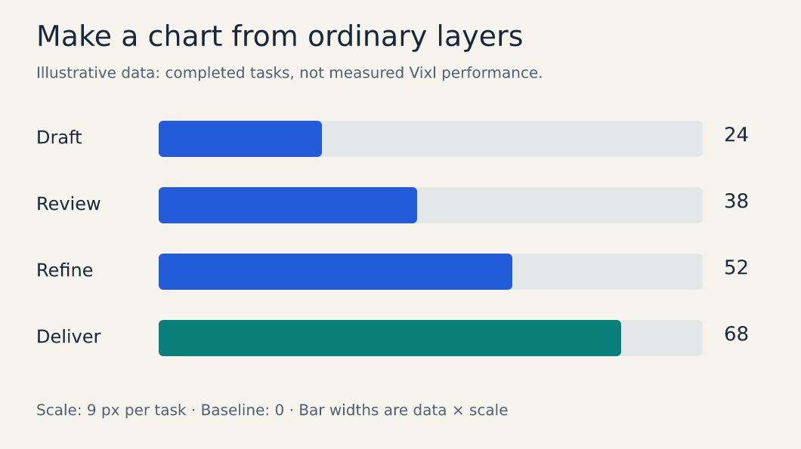

<picture>
  <source media="(prefers-color-scheme: dark)" srcset="assets/brand/ripple/SVG/horizontal-reverse.svg">
  
</picture>

# Vixl

**Ideas become editable.** A design engine for AI agents.

Ask an AI for a poster and you usually get a picture of a poster. Vixl gives your agent the
real thing: layers, live text, fonts, a history you can rewind, and a `.vixl` master you can
still change next week. It checks contrast, spacing and bleed before export, so nobody finds
out at the print shop.

It runs through MCP, CLI, Python or REST, so there is no canvas to open. People can drive the same
interfaces; the product is built for the agent at the keyboard.

Pre-1.0 and in Beta: breaking changes are allowed and noted in the [changelog](CHANGELOG.md#0270).
Current tagged release: **0.27.0**. Run `vixl --version` to check your runtime; record the Git commit when using a
source checkout.

**[Documentation home](docs/README.md)** · [Getting started](docs/getting-started.md) ·
[Visual gallery](docs/gallery.md) · [Use cases](docs/use-cases.md) · [Command reference](docs/reference/commands.md) ·
[Troubleshooting](docs/troubleshooting.md) · [Downloads](https://github.com/jxburros/Vixl/releases/latest) · [Examples and showcases](https://github.com/jxburros/VixlExamples)


## Programmable. Editable. Checked.

- **Programmable.** One JSON operation format behind MCP, the CLI, Python and REST. Batches of up to
  10,000 operations apply atomically, so a half-finished edit never lands.
- **Editable.** Text stays text, effects stay a stack, and history branches. Charts open in PowerPoint
  as real charts, forms export as PDFs people can fill in, and every piece ships with its master.
- **Checked.** Contrast, spacing, bounds, fonts, trim and bleed are measured, your brief can be saved as
  a test suite, and you preview the render before anything is exported.

## Start with an agent

After you [install](#install), point your agent at a workspace folder and give it a brief:

```bash
vixl mcp --workspace .
```

Then ask for something with a deadline in it: "A 1080x1350 launch poster for the Saturday market, our brand
colours, headline *Fresh Saturday*, and a version for stories." The agent creates the document, applies
operations, checks contrast and spacing, looks at the render, and hands you the `.vixl` master plus exports.
Change the headline next week and nothing is redrawn.

For a pinned tagged runtime with uv:

```bash
uvx --from https://github.com/jxburros/Vixl/archive/refs/tags/v0.27.0.tar.gz vixl mcp --workspace .
```

The workspace must exist. The server offers seven tools (`vixl_document`, `vixl_apply`, `vixl_check`,
`vixl_render`, `vixl_export`, `vixl_reference`, `vixl_job`) in about 7,700 characters of tool list; agents
look up operation fields and rarer options on demand with `vixl_reference`
([MCP tool surface](docs/reference/mcp-toolsets.md)). Use `--tools ai` for a second server with the provider-backed
tools, or `--http` for Streamable HTTP.
[Interface setup](docs/reference/interfaces.md) includes client JSON, multi-document sessions,
REST authentication, imports and live human review (`vixl -p hello.vixl view`).

The [Vixl agent skill](skills/vixl/SKILL.md) teaches the inspect → apply → check → finishing pass
(critique, one fix batch, a real-size look) → export loop, recipes and operation details. Copy its folder to your agent's skills
directory. AI functions use explicitly configured providers; Vixl contains no model weights.

## What you can make

Each row is a place to start; the [use-case catalog](docs/use-cases.md) and the
[documentation home](docs/README.md) list the rest, grouped by how long each takes.

| Goal | Start here |
| --- | --- |
| Posters, social graphics and branded variants | [Campaign tutorial](docs/tutorials/campaign.md), [sizes and layouts](docs/guides/layout/sizes-and-layouts.md), [brands](docs/guides/layout/brands.md) |
| Charts, diagrams and infographics | [Editable chart tutorial](docs/tutorials/charts.md), [flowcharts and diagrams](docs/guides/shapes/diagrams.md) |
| Decks and booklets that open in PowerPoint | [Forms and decks tutorial](docs/tutorials/forms-and-decks.md), [slides](docs/guides/output/slides.md) |
| Fillable PDF forms, filled from a CSV | [Forms](docs/guides/output/forms.md) |
| Print-ready files, checked before the print shop | [Color and print](docs/guides/finishing/color-and-print.md), [checking designs in CI](docs/guides/automation/ci.md), [outcomes and repair](docs/reference/agent-trust.md) |
| Designs from Figma, SVG and PDF, and back again | [Figma import](docs/guides/images/figma.md), [SVG and PDF import](docs/guides/output/exporting.md#importing-svg-and-pdf), [the `.vixl` file format](docs/reference/file-format.md) |
| Motion, sprites and lyric videos | [Motion tutorial](docs/tutorials/motion.md), [lyric videos](docs/guides/motion/lyric-video.md) |
| Photo edits, drawings and painted artwork | [Filters](docs/guides/images/artistic-filters.md), [drawing cleanup](docs/guides/images/drawing.md), [brushes](docs/guides/motion/brushes-and-animation.md) |
| AI generation and vision | [Provider setup](docs/reference/providers.md); external services required |

## Install

On Windows, download the latest **Vixl-Setup-VERSION-windows-x64.exe** from
[GitHub Releases](https://github.com/jxburros/Vixl/releases/latest). It bundles Python,
REST and MCP, installs for your user account, and supports verified automatic updates.
If `vixl` is not found, reopen the terminal or see [PATH repair](docs/reference/releases.md#using-the-current-terminal).

```text
vixl --version
vixl update --check
vixl update
```

For source development, use Python 3.11+:

```bash
git clone https://github.com/jxburros/Vixl.git
cd Vixl
python -m venv .venv
# macOS/Linux:
source .venv/bin/activate
# Windows PowerShell: .venv\Scripts\Activate.ps1
python -m pip install -e '.[server,pdf]'
vixl --version
```

The core install is `python -m pip install -e .`; MCP is included. Optional `server`
adds REST/live review, and `pdf` adds PDF page import. Pip installs use pip-managed
updates. [Installation and releases](docs/reference/releases.md) covers pinned versions, Windows
rollback, agent bundles and packaging.

## Or drive it yourself

Six commands, one checked design, still fully editable. The agent runs the same operations:

```bash
vixl new 800x600 --background '#18283b' -o hello.vixl
vixl -p hello.vixl text add 'Hello, Vixl' --name title --size 64 --color '#ffffff'
vixl -p hello.vixl align title center
vixl -p hello.vixl check --checks bounds contrast
vixl -p hello.vixl render --out hello-preview.png
vixl -p hello.vixl export hello.png
```

In a terminal each command prints a short summary; piped output, `--json` and `VIXL_JSON=1` give the full JSON.
Editing commands autosave; pass `-p` explicitly in scripts. Inspect the preview before
handoff. The [first-design walkthrough](docs/getting-started.md) explains undo,
checkpoints, JSON batches and Python. Use the bundled font for proofing; choose suitable
[typography](docs/guides/text/typography.md) for finished work.

## Use Python

```python
from vixl import Project

project = Project(800, 600, background="#18283b")
project.apply([
    {"type": "text", "name": "title", "text": "Hello, Vixl", "size": 64, "color": "#ffffff"},
    {"type": "align", "target": "title", "alignment": "center"},
])
project.save("hello.vixl")
project.export("hello.png")
```

All interfaces share canonical operations and atomic batches. Direct Python requires
an explicit save. See [document concepts](docs/concepts.md), [operation semantics](docs/reference/operations.md)
and [Python/REST/MCP](docs/reference/interfaces.md) for deeper integration.

## Examples and development



[Editable chart](docs/assets/generated/chart.vixl) · [Recipe](docs/assets/generated/chart.json)
· [Visual capability gallery](docs/gallery.md)

```bash
python -m pip install -e '.[dev]'
python examples/build_documentation.py
python examples/build_poster.py --output examples/output
python examples/build_sprite.py --output examples/output/sprite
python examples/build_filter_gallery.py
python examples/build_organic_gallery.py
python examples/build_irregular_gallery.py
python examples/build_drawing_pipeline.py
python -m pytest -q
```

The documentation builder creates diagrams, charts, artwork, forms, slides and motion
without AI credentials or network access. Every new visual has an editable master and
operation recipe; see [documentation maintenance](docs/project/documentation-maintenance.md).
Showcases, explorations, the marketing pack, promo films and evaluation results live in
[VixlExamples](https://github.com/jxburros/VixlExamples), and
[agent evaluations](evals/README.md) measure design tasks. The [development plan](docs/project/roadmap.md) and
the [craft plan](docs/project/craft-plan.md) order the open work, [render parity](docs/project/render-parity.md) measures raster
output against Chromium, and [brand voice](docs/project/brand-voice.md) describes how Vixl's own copy sounds.

Vixl edits in RGBA8 sRGB and exports supported vectors or documented raster fallbacks.
CMYK is an export setting. RAW development, spot-color editing, PSD/XCF import
(PSD export is layered pixels) and a desktop GUI are outside this implementation. Review
[coverage and limitations](docs/reference/coverage.md), [export behavior](docs/guides/output/exporting.md) and
[architecture](docs/reference/architecture.md) before choosing it for a workflow.
The [original product specification](docs/project/product-spec.md) is retained as design context.
The [Ripple identity kit](assets/brand/ripple/START-HERE.md) includes logos,
icons, an animated wordmark, usage guidance and editable masters.

## Licence

Vixl is source-available under the [PolyForm Small Business License 1.0.0](LICENSE): free for
individuals and for companies with fewer than 100 people and under US$1M (2019) revenue; larger
companies need a commercial licence from the licensor (to ask about one, open an issue or contact
[@jxburros](https://github.com/jxburros) on GitHub). Copies of Vixl must carry the licence and
its `Required Notice:` lines. If Vixl helped make your work, please credit it ("Made with Vixl").

Bundled assets keep their own terms: DejaVu Sans ([font licence](src/vixl/data/FONT-LICENSE.txt)), the Noto Sans,
Noto Sans Symbols, Noto Sans Symbols 2 and Noto Sans Math fallback fonts ([SIL OFL 1.1](src/vixl/data/NOTO-LICENSE.txt)),
the xkcd colour names (CC0), and VIXL Line emoji artwork adapted from OpenMoji
([CC BY-SA 4.0](src/vixl/data/emojis/LICENSE.txt); [Unicode data license](src/vixl/data/emojis/UNICODE-LICENSE.txt)).
