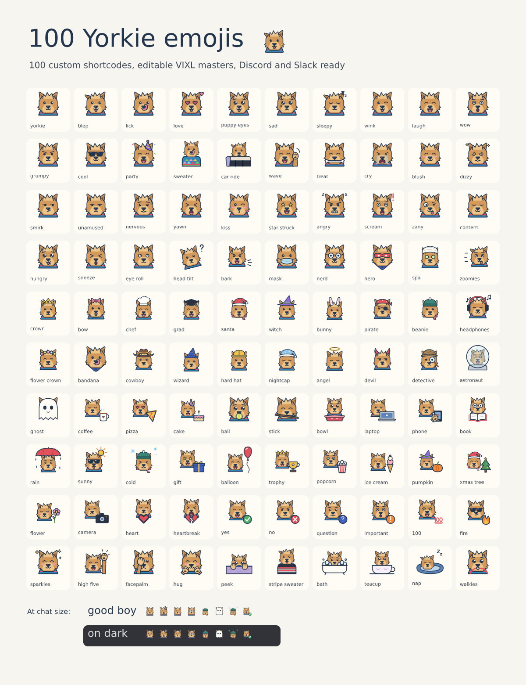

# Yorkie emojis

100 custom emojis of a Yorkshire terrier: a golden topknot, upright ears (one flops on car rides),
a tongue that is usually out, and the blue harlequin and striped knit sweaters. They are drawn in
the VIXL Line style: 72×72 canvas, navy `#23364D` 1.7 px outlines, with details kept inside the 8 px margin.



| Group | Shortcodes |
| --- | --- |
| Faces and moods (35) | `:yorkie:` `:yorkie_blep:` `:yorkie_lick:` `:yorkie_love:` `:yorkie_puppy_eyes:` `:yorkie_sad:` `:yorkie_sleepy:` `:yorkie_wink:` `:yorkie_laugh:` `:yorkie_wow:` `:yorkie_grumpy:` `:yorkie_cool:` `:yorkie_cry:` `:yorkie_blush:` `:yorkie_dizzy:` `:yorkie_smirk:` `:yorkie_unamused:` `:yorkie_nervous:` `:yorkie_yawn:` `:yorkie_kiss:` `:yorkie_star_struck:` `:yorkie_angry:` `:yorkie_scream:` `:yorkie_zany:` `:yorkie_content:` `:yorkie_hungry:` `:yorkie_sneeze:` `:yorkie_eye_roll:` `:yorkie_head_tilt:` `:yorkie_bark:` `:yorkie_mask:` `:yorkie_nerd:` `:yorkie_hero:` `:yorkie_spa:` `:yorkie_zoomies:` |
| Hats and costumes (21) | `:yorkie_crown:` `:yorkie_bow:` `:yorkie_chef:` `:yorkie_grad:` `:yorkie_santa:` `:yorkie_witch:` `:yorkie_bunny:` `:yorkie_pirate:` `:yorkie_beanie:` `:yorkie_headphones:` `:yorkie_flower_crown:` `:yorkie_bandana:` `:yorkie_cowboy:` `:yorkie_wizard:` `:yorkie_hard_hat:` `:yorkie_nightcap:` `:yorkie_angel:` `:yorkie_devil:` `:yorkie_detective:` `:yorkie_astronaut:` `:yorkie_ghost:` |
| Treats, toys and things (23) | `:yorkie_coffee:` `:yorkie_pizza:` `:yorkie_cake:` `:yorkie_ball:` `:yorkie_stick:` `:yorkie_bowl:` `:yorkie_laptop:` `:yorkie_phone:` `:yorkie_book:` `:yorkie_rain:` `:yorkie_sunny:` `:yorkie_cold:` `:yorkie_gift:` `:yorkie_balloon:` `:yorkie_trophy:` `:yorkie_popcorn:` `:yorkie_ice_cream:` `:yorkie_pumpkin:` `:yorkie_xmas_tree:` `:yorkie_flower:` `:yorkie_camera:` `:yorkie_heart:` `:yorkie_heartbreak:` |
| Reactions (11) | `:yorkie_yes:` `:yorkie_no:` `:yorkie_question:` `:yorkie_important:` `:yorkie_100:` `:yorkie_fire:` `:yorkie_sparkles:` `:yorkie_high_five:` `:yorkie_facepalm:` `:yorkie_hug:` `:yorkie_peek:` |
| Scenes (10) | `:yorkie_party:` `:yorkie_sweater:` `:yorkie_car_ride:` `:yorkie_treat:` `:yorkie_wave:` `:yorkie_stripe_sweater:` `:yorkie_bath:` `:yorkie_teacup:` `:yorkie_nap:` `:yorkie_walkies:` |

## Files

- `packs/yorkie-discord.zip`, `packs/yorkie-slack.zip`: 128 px PNGs that pass each destination's checks,
  plus SVGs, VIXL masters, `index.html` preview and upload instructions.
- `packs/yorkie-images-512.zip`: 512 px transparent PNGs (stickers, messaging apps).
- `masters/*.vixl`: one editable master per emoji (separate vector shape layers); `svg/` holds the sources.
- `yorkie-emojis.vixl`: a document with all 100 registered as custom shortcodes. Type `:yorkie_blep:` in any of its text layers.

## Rebuild or edit

Change the shapes in `yorkie_art.py` (the head and the first 17) or `yorkie_extra.py` (hats, props, paws and the other 83), then run `python art/yorkie-emojis/build.py` from the repository root.
Or edit a master directly and register it again:

```bash
vixl -p art/yorkie-emojis/masters/yorkie.vixl render --out yorkie.png
vixl -p art/yorkie-emojis/yorkie-emojis.vixl emoji replace ':yorkie:' art/yorkie-emojis/masters/yorkie.vixl --name yorkie
vixl -p art/yorkie-emojis/yorkie-emojis.vixl emoji export --destination discord --out my-discord.zip
```
