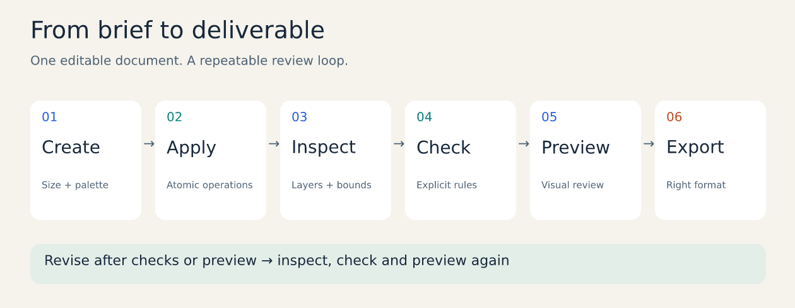

# Vixl documentation

Your agent makes the poster, and you keep the layers. Vixl creates and edits layered designs through MCP,
commands, Python or REST. There is no desktop canvas to learn: create a document, apply operations, inspect it,
check it, preview the result and export. Text, geometry, masks, effects and history stay in the `.vixl` master.

## Work with an agent

Use `vixl mcp --workspace .`: seven tools, with operation fields and rarer options looked up through
`vixl_reference` ([MCP tool surface](reference/mcp-toolsets.md)). Give the agent a brief with
dimensions, audience, copy, assets, brand rules and required outputs. Ask it to inspect and
preview before handing off the editable master and exports. [Interface setup](reference/interfaces.md)
includes client JSON, authentication and HTTP transport; [studio](guides/automation/studio.md) covers review,
tests and independent branch documents.

AI generation, semantic selection and natural-language planning use configured external
providers. Layouts, charts, paint, effects, forms and the gallery work without AI credentials.
See the [provider matrix](reference/providers.md#capability-matrix) before choosing a service.

## Start here

New to Vixl? [What Vixl is](overview.md) explains it in one sitting: the problem, how it works, what it makes
and where it stops.

1. [Install and make your first design](getting-started.md): a complete CLI and Python walkthrough.
2. [Understand the document](concepts.md): layers, coordinates, constraints, assets and history.
3. [Explore the visual gallery](gallery.md): actual Vixl output with editable masters and recipes.
   The [use-case catalog](use-cases.md) lists what you can make, grouped by how long each takes.
4. [Choose an export format](guides/output/exporting.md): images, vectors, print, decks, forms and motion.
5. [Resolve common problems](troubleshooting.md): installation, text, checks, imports and providers.

Pre-1.0 and in Beta: breaking changes are allowed and noted in the [changelog](../CHANGELOG.md). Current tagged
release: **0.30.6** ([release notes](../CHANGELOG.md#0306)).
See [installation and updating](reference/releases.md) for Windows, source and agent bundles.

## Learn by making

Run tutorials from the repository root after installing Vixl. Their input JSON, images
and editable documents are committed under `docs/assets/generated/`; all visuals rebuild
offline with `python examples/build_documentation.py`.

| Goal | Tutorial | What you learn |
| --- | --- | --- |
| Make reusable social or event artwork | [Campaign and variants](tutorials/campaign.md) | Variables, text edits, checkpoints, CSV output |
| Explain data visually | [Editable charts](tutorials/charts.md) | Data-to-geometry mapping, labels, SVG, slide reuse |
| Produce registration materials and presentations | [Forms and decks](tutorials/forms-and-decks.md) | Field validation, fillable PDF, pages, notes, PowerPoint |
| Add movement | [Motion and pixel art](tutorials/motion.md) | Keyframes, frame previews, animated WebP, sprite frames |

## How the documentation is organized

| Folder | What is in it | Read it when |
| --- | --- | --- |
| This folder | [What Vixl is](overview.md), [getting started](getting-started.md), [concepts](concepts.md), [gallery](gallery.md), [use-case catalog](use-cases.md), [troubleshooting](troubleshooting.md) | You are new, or looking for what Vixl can make |
| [`tutorials/`](tutorials/) | Four end-to-end walkthroughs that build a complete artifact | You learn by doing |
| [`guides/`](guides/README.md) | Task-oriented guides for one feature area each, grouped by layout, shapes, finishing, text, images, motion, output and automation | You know what you want to make |
| [`reference/`](reference/README.md) | Commands, operations, file format, interfaces, providers, plugins, architecture, coverage, releases | You need exact syntax, fields or limits |
| [`project/`](project/README.md) | House-style decisions, plans, the original specification, render parity, brand voice and how to maintain these docs | You work on Vixl itself |
| [`assets/`](assets/) | Generated visuals, editable masters, JSON recipes and gallery images used by the pages | You rebuild or reuse a picture |

## Find a feature

The full index, by area. If you have a goal rather than a feature, start from the [use-case catalog](use-cases.md).

| Area | Guides and references |
| --- | --- |
| Documents and authoring | [Concepts](concepts.md), [the `.vixl` file format](reference/file-format.md), [converting documents and tool calls from earlier releases](reference/converting.md), [CLI authoring and checks](reference/authoring.md), [commands](reference/commands.md), [operation semantics](reference/operations.md) |
| Starting points | [Safe design variety and the house style](guides/layout/safe-variety.md), [Containers and templates](guides/layout/containers-and-templates.md), [Sizes and layouts](guides/layout/sizes-and-layouts.md), [palettes, templates and resources](guides/layout/agent-resources.md), [brands](guides/layout/brands.md), [design styles](guides/layout/styles.md), [guides and grids](guides/layout/guides.md) |
| Text and emoji | [Typography](guides/text/typography.md), [making a font](guides/text/custom-fonts.md), [rich text](guides/text/rich-text.md), [text flow](guides/text/text-flow.md), [emoji library and custom packs](guides/text/emojis.md) |
| Shapes and objects | [Objects: kinds, parts, isolated review and export](guides/shapes/objects.md), [Vector paths and strokes](guides/shapes/vector-paths.md), [Spatial queries and transforms](guides/shapes/spatial-transforms.md), [Design tools](guides/shapes/design-tools.md), [organic shapes](guides/shapes/organic.md), [diagrams and flowcharts](guides/shapes/diagrams.md) |
| Finishing and imperfection | [Looks](guides/finishing/looks.md), [scene atmosphere and motifs](guides/finishing/atmosphere.md), [irregularity and torn edges](guides/finishing/irregular.md), [color and print](guides/finishing/color-and-print.md) |
| Images and drawing | [Import from Figma](guides/images/figma.md), [SVG and PDF import as editable layers](guides/output/exporting.md#importing-svg-and-pdf), [Materials and media review](guides/images/media-craft.md), [Drawing cleanup](guides/images/drawing.md), [artistic filters](guides/images/artistic-filters.md), [irregular image frames and paint drips](guides/shapes/design-tools.md#irregular-image-frames-and-paint-simulation) |
| Output | [Export guide](guides/output/exporting.md) (including the [SVG round trip](guides/output/exporting.md#svg-round-trip)), [accessibility](guides/output/accessibility.md), [slides](guides/output/slides.md), [marketing build options](guides/output/marketing-builds.md) (deck legibility profiles, image downsampling), [HTML presenter](guides/output/presenter.md), [forms](guides/output/forms.md) |
| Data and reuse | [Charts](guides/output/charts.md), [linked documents](guides/output/linked-documents.md), [data merge and print imposition](guides/output/imposition.md), [QR codes and barcodes](guides/output/codes.md) |
| Motion | [Characters, rigs and scene authoring](guides/motion/animation-authoring.md), [Brushes and timelines](guides/motion/brushes-and-animation.md), [pixel animation and spacing](guides/motion/pixel-animation-spacing.md), [lyric video](guides/motion/lyric-video.md), [video templates](guides/motion/animation-authoring.md#joint-pose-keys-and-short-templates), [app animation packages](guides/motion/animation-authoring.md#app-animation-packages) |
| Automation and collaboration | [Production workflows](guides/automation/production.md) (proof pages, logo packages), [outcomes, diagnostics and repair](reference/agent-trust.md), [studio and custom tests](guides/automation/studio.md), [checking designs in CI](guides/automation/ci.md), [Git-reviewable source folders](reference/commands.md#reviewing-editable-projects-in-git), [local screen capture](reference/commands.md#local-desktop-capture) |
| AI | [Provider setup and capability matrix](reference/providers.md) |
| Integration | [Capability discovery](reference/agent-discovery.md), [MCP tool surface](reference/mcp-toolsets.md), [Python, REST and MCP](reference/interfaces.md), [agent skill](../skills/vixl/SKILL.md), [plugins and content packs](reference/plugins.md) |
| Installation | [Releases, updates and rollback](reference/releases.md) |
| Contributors and project records | [Project documentation](project/README.md): [house style decisions](project/house-style.md), [development plan](project/roadmap.md), [craft plan](project/craft-plan.md), [implementation plan](project/implementation-plan.md), [use-case evidence](project/use-case-evidence.md), [render parity](project/render-parity.md), [documentation maintenance](project/documentation-maintenance.md), [brand voice](project/brand-voice.md), [original specification](project/product-spec.md) |

## Deeper examples

- [Architecture and resource limits](reference/architecture.md) and [implementation coverage](reference/coverage.md).
- [Examples](../examples/) and [explorations](https://github.com/jxburros/VixlExamples/blob/main/explorations/README.md): longer creative projects.
- [Changelog](../CHANGELOG.md): shipped changes and source-only additions.

## Contributors

Working on Vixl itself? [CONTRIBUTING](../CONTRIBUTING.md) has the rules, and [project documentation](project/README.md)
holds the decision records, plans, the use-case evidence, render parity, brand voice, documentation maintenance and the
original product specification. [Agent evaluations](../evals/README.md) hold the briefs and grading contracts.

[Back to the project](../README.md)
