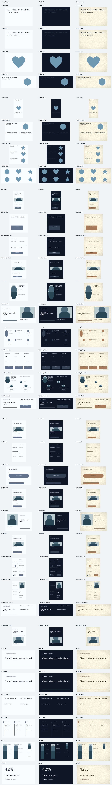

# Containers, template variants and comic pages

[Documentation home](../../README.md) · [Getting started](../../getting-started.md) · [Visual gallery](../../gallery.md)

Containers are editable groups with semantic text and image slots. Their local layout can reflow at a new size, and named variants preserve the filled content. `vixl_apply(workflow='resource-get', request={"kind":"containers","name":"profile"})` returns the resource's slots, defaults, bounds and variants. Use `kind: "templates"` to inspect a template's category, supported named sizes, slots and recommended looks.

## Place, fill and rearrange

```json
[
  {"type":"palette-apply","name":"slate"},
  {"type":"container-place","name":"person","resource":"profile","variant":"left","seed":42,"width":600,"height":400,"variables":{"name":"Ana Rivera","title":"Designer","bio":"Making complex ideas clear","photo":"assets/IMPORTED_HASH.png"}},
  {"type":"container-variant","target":"person","variant":"centered"},
  {"type":"container-fill","target":"person","variables":{"title":"Design lead"}},
  {"type":"resize","target":"person","width":720,"height":500}
]
```

Import the image first with `import-image` and use its returned asset ID. Python and CLI calls can also supply an image path inside the workspace; services accept embedded assets only. Source images remain embedded, so resizing recrops from the source rather than a previously cropped thumbnail.

`container-variant` preserves the group identity, image source, supplied variables and direct edits to slot text. It recreates the arrangement's children; use `container-reflow` when existing child IDs need to stay unchanged. `container-swap` replaces the resource while carrying compatible named variables across. Resources with different base sizes require explicit dimensions. Changing a size updates the group's local layout box, wraps/fits opted-in text and recomputes image crops. It does not geometrically stretch the group. An impossible fit or min/max violation fails atomically.

Omitting a seed selects a fresh one. Placement reports its seed and selected variant; save them to reproduce a composition. Explicit choices and workspace brand values take precedence.

## Built-in containers

| Resource | Slots | Arrangements |
| --- | --- | --- |
| `stat` | value, label, optional delta | default |
| `testimonial` | quote, name, role, photo | left, centered, split |
| `feature-icon` | title, body, geometric icon | left, centered, split |
| `cta` | title, button | default |
| `pricing-tier` | plan, price, features, button | default |
| `profile` | photo, name, title, bio | left, centered, split |
| `timeline-step` | date, title, body | default |
| `list-block` | title, items (plain, bulleted or numbered text) | default |
| `badge`, `ribbon` | label | default |
| `photo-caption` | photo, caption | default |
| `product-card` | photo, name, price, optional tag | left, centered, split |
| `section-header` | eyebrow, title (a rule closes it) | default |
| `key-value-list` | title, items (one `label \| value \| share` per line) | default |
| `callout` | title, body and an optional icon (a symbol or emoji) on a tinted panel with an accent rule | default |
| `band` | title and an optional detail on an accent strip (960×160 by default) | default |
| `labelled-rule` | label between two rules (720×96 by default) | default |

The original headline, quote, feature and illustration containers remain available. Text and decorations use palette role swatches. Image-bearing resources show crossed neutral placeholders until filled. Both the normal blanks check and the `container-layout` suite report missing image slots; the container suite also reports sources with fewer pixels than the displayed image requires.

The finishing pieces `callout`, `band` and `labelled-rule` are placed on purpose, never picked by a roll (like
`key-value-list`), so rolled documents stay as they were. A callout's panel is the surface tinted 12% toward the accent;
its icon sits in the top corner and hides when empty, so the copy keeps its place either way. A band is a wide, short
strip for a header or footer: its text is `@on-accent` on `@accent`, and the detail at the far end hides when empty.
A labelled rule divides sections ("Chapter two", "or") with the label's capitals centred on the rules. Give each the
size it needs; the strips accept heights down to 64 and 40 px.

```json
[{"type": "palette-apply", "name": "slate"},
 {"type": "container-place", "name": "note", "resource": "callout", "x": 60, "y": 60,
  "variables": {"title": "Heads up", "body": "Doors open at seven.", "icon": "!"}},
 {"type": "container-place", "name": "footer", "resource": "band", "x": 0, "y": 680, "width": 1200, "height": 120,
  "variables": {"title": "Summer Night Market", "detail": "June 21"}},
 {"type": "container-place", "name": "divider", "resource": "labelled-rule", "x": 240, "y": 460,
  "variables": {"label": "Chapter two"}}]
```

The section header's rule keeps at least one spacing unit (half the document's body size) between itself and the container's bottom edge at any height, so the row that follows never sits on it (the [craft plan](../../project/craft-plan.md) counts a gap under half a unit as crowding; one unit keeps clear of that threshold).

Custom resources can declare `min_width`, `max_width`, `min_height`, `max_height` and named `variants`, each containing `operations` and optional `rules`. Local content supports `frame: [x, y, width, height]` in fractions of the container, plus `fit_text: true` and `min_size` on text operations, and `clear_below` (spacing units kept between an item and the container's bottom edge). A text frame wraps and shrinks only as far as its minimum; overly long copy is rejected rather than clipped. Vertical, horizontal and grid rules continue to support padding, gaps, columns and hidden-member collapse.

An image operation inside a resource can declare:

```json
{"type":"image-slot","name":"portrait","slot":"photo","width":200,"height":200,"fit":"cover","focal":[0.65,0.35],"mask_shape":"circle"}
```

`cover` crops around the focal point, `contain` letterboxes with transparency, and `fill` stretches. `mask_shape` accepts supported shape silhouettes, with `rect`, `rounded` and `circle` aliases; rounded masks accept `radius`. Source resolution is independent of the cropped asset generated for rendering.

## Key-value lists

`key-value-list` sets rows of a label, a value and an optional share in aligned columns: labels flush left,
values right-aligned on one edge and shares on another, with a hairline rule between rows. Right-aligned
columns keep figures lined up even in fonts whose digits are proportional. Row padding and column gaps come
from the spacing scale for the text size (one unit above and below each line, two units between columns),
and every single-line row has the same height. The result is a group of ordinary text layers and rules that
keeps its rows under `key_values`; `key-value-list` with `target` restyles it, resizes it or gives it new rows
on the same layer IDs.

```json
[
  {"type":"key-value-list","name":"shares","x":80,"y":80,"width":420,"number_format":"#,##0","shares":"auto",
   "rows":[{"label":"Drip","value":15900},{"label":"Espresso","value":11960},{"label":"Cold brew","value":2510},{"label":"Tea","value":5260}]},
  {"type":"key-value-list","target":"shares","font_size":22,"colors":["#0072b2","#e69f00","#009e73","#cc79a7"]}
]
```

- Rows: `rows` as `{label, value, share}` objects or `[label, value, share]` lists, or `items` as text, one
  `label | value | share` per line (the same convention as the `price-list` layout). Numbers take
  `number_format`; `shares: "auto"` computes each value's share of the total.
- `width`: values and shares move to its right edge and labels wrap to the room left; without it the list is
  as wide as its widest row. `font_size` defaults to the document's body size.
- Look: `font`, `value_font`, `text_color`, `share_color` (default: the muted text color, still 4.5:1),
  `rules` (default true), `rule_color`, and `colors` for a swatch before each label.
- A chart's `legend_values` legend is the same list (see [charts](../output/charts.md)), so a chart and a separate
  summary list of the same numbers line up.
- The `key-value-list` container places one under a title; `container-fill` with new `items` rebuilds it, and
  resizing the container widens the list to its frame and steps the text down (to `min_size`) until the rows
  fit.

## Hug-content buttons and badges

```json
[
  {"type":"text","name":"button-label","text":"${action}","size":24,"color":"white"},
  {"type":"stack","name":"button","targets":["button-label"],"size":"hug","background":"#245a70","radius":24,"padding":{"top":10,"right":20,"bottom":10,"left":20}}
]
```

Define the `action` variable before applying this example. Hug stacks measure visible children plus padding at render time. Updating the text or export variables adjusts both the box and its background; nested horizontal stacks adjust gaps and positions too. `stroke` and `stroke_width` add an outline. Padding can be uniform or per side. `size: "fixed"` keeps the traditional stack behavior, and `remove: true` freezes the current geometry before releasing the layout.

## Use-case templates

- Social: `social-story`, `social-carousel` (three pages), `social-announcement`, `social-event-promo`, `social-quote`.
- Marketing: `marketing-hero`, `marketing-features`, `marketing-pricing`, `marketing-testimonials`, `marketing-launch`.
- Print: `print-flyer`, `print-menu`, `print-certificate`, `print-invitation`, `print-postcard`, `print-poster`.
- Business: `business-one-pager`, `business-case-study`, `business-invoice-header`, `business-report-cover`.
- Slides: `slide-title`, `slide-section`, `slide-comparison`, `slide-timeline`, `slide-team`, `slide-stat`.
- Promo video: `video-promo-kinetic`, `video-promo-editorial`, `video-promo-neon`, `video-promo-spotlight`, `video-promo-split`, `video-promo-stat`; add `-story` or `-wide` for portrait or widescreen. Six-second editable loops with distinct layouts and motion, using `title`, `subtitle`, `cta` and seeded colors. See the [preview pack](https://github.com/jxburros/VixlExamples/blob/main/promo/variety/README.md).
- Short video: `video-tip`, `video-launch`, `video-event` (six-second seamless loops with `title`, `subtitle` and `cta` variables; see [animation authoring](../motion/animation-authoring.md#joint-pose-keys-and-short-templates)). They scale to any canvas and carry no container grid.

Create the canvas at one of the template's declared sizes, then apply it. Its grid computes cells from the current canvas, including padding and gutters. `columns` changes the grid; cells smaller than a usable container are refused. Print canvas metadata is retained. Each template includes the `container-layout` check suite. Unfilled text remains an explicit placeholder.

```json
{"type":"template-apply","name":"marketing-pricing","seed":42,"palette":"coffee","look":"paper","columns":3,"variables":{"slot-1":{"plan":"Starter","price":"$19","features":"One workspace\nShared projects","button":"Start now"},"slot-2":{"plan":"Team","price":"$49","features":"Five workspaces\nShared libraries","button":"Choose Team"},"slot-3":{"plan":"Studio","price":"$99","features":"Unlimited workspaces\nPriority support","button":"Contact us"}}}
```

Every modular/use-case template recommends minimal/light (`slate`, no finish), bold/dark (`midnight`, soft shadow), and warm/editorial (`coffee`, paper). `mode` selects light or dark, `palette` selects colors, `look` selects a finishing recipe, and `style` applies a catalog style's guidance and checks. The template result records the seed and choices. The gallery below renders all three recommended combinations with filled slots; regenerate it using `python examples/build_template_gallery.py`, which also checks all 102 combinations.



## Comic storytelling

`comic-layout` lays out a narrative panel sequence with configurable gutters, margins, borders and left-to-right or right-to-left reading order. Panels can span multiple columns, carry image slots, wrap a caption, and contain speech/thought/shout/whisper dialogue. Output remains editable groups, text, shapes and image layers.

```json
{"type":"comic-layout","name":"chapter-1","columns":2,"gutter":20,"reading_order":"rtl","panels":[{"caption":"A quiet morning","image":"assets/IMPORTED_HASH.png","dialogue":[{"text":"Something is different today.","style":"thought","x":0.08,"y":0.08}]},{"caption":"Across the street"},{"caption":"The whole picture","span":2}]}
```

The result records ordered panel IDs and bounds. Missing artwork is flagged as a blank. Dialogue uses the speech-bubble primitive and its anchor-following tails. For multiple comic pages, use the normal `page` operation, then apply `comic-layout` to each page.
