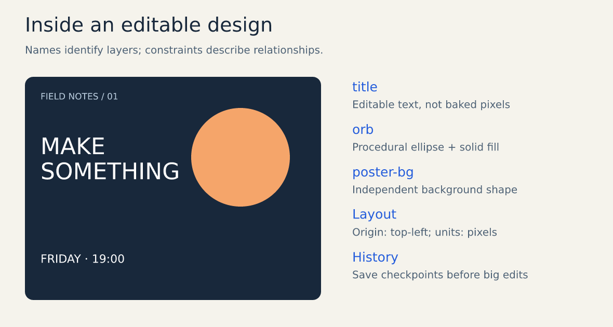

# What Vixl is

[Documentation home](README.md) · [Getting started](getting-started.md) · [Visual gallery](gallery.md) ·
[Use cases](use-cases.md) · [Coverage and limitations](reference/coverage.md)

**Ideas become editable.** Vixl is a design engine for AI agents. Your agent makes the poster; you keep the layers.

This page is the one-sitting overview: what Vixl is, how it works, what it makes and where it stops. It's written for
people deciding whether to use it, and for anyone who has to explain it to someone else.


## The problem

Ask an AI for a poster and you usually get a picture of a poster. It looks fine until somebody wants the date changed,
the logo moved, a version for stories or a CMYK file for the print shop. Then there's nothing to edit: the text is
pixels, the layout is pixels, and the only fix is to generate it again and hope.

Desktop design tools have the layers, but they're built for a mouse. An agent driving one has to click through a canvas
it can't see properly, and nothing tells it whether the result is any good.

## What Vixl does

Vixl gives the agent the real thing: a layered document it builds with structured operations, checks with measurements
and looks at before handing off. Text stays text, effects stay a stack, history branches, and every deliverable ships
with a `.vixl` master you can still change next week.

| | The question | What Vixl answers with |
| --- | --- | --- |
| **Editable** | Can I still change it? | Layered `.vixl` masters with branching history. Charts open in PowerPoint as real charts; forms export as PDFs people can fill in; masters unpack into Git-reviewable source folders. |
| **Programmable** | Can my agent drive it? | One JSON operation format behind MCP, the CLI, Python and REST. Batches of up to 10,000 operations apply atomically, so a half-finished edit never lands. Headless: no display, no canvas. |
| **Checked** | Can I trust it? | Contrast, spacing, bounds, fonts, trim, bleed, accessibility and composition are measured. Briefs become saved test suites. Every render can be previewed before export, and every result says whether it was validated. |

## How it works

Every interface compiles to the same canonical operations and the same engine:

```text
   MCP  ·  CLI and scripts  ·  Python  ·  REST  ·  AI planner
                          |
           schema-checked canonical operations
                          |
      atomic candidate document + state validation
                          |
     history (a DAG of revisions) + embedded asset store
                          |
   variables · constraints · layout · Pillow/NumPy renderer
                          |
 PNG · JPEG · WebP · TIFF · AVIF · SVG · PDF · PPTX · PSD · HTML · motion
```

An edit is a batch of JSON operations. Vixl validates the whole batch, applies it to a candidate copy of the document,
validates the result and only then commits it as one history entry. If any operation fails, nothing changes and the
error names the operation, the field and the closest valid values. The same two operations, from Python:

```python
from vixl import Project

project = Project(800, 600, background="#18283b")
project.apply([
    {"type": "text", "name": "title", "text": "Hello, Vixl", "size": 64, "color": "#ffffff"},
    {"type": "align", "target": "title", "alignment": "center"},
])
project.save("hello.vixl")
project.export("hello.png")
```

The agent's working loop is **inspect → apply → check → preview → export**:

1. **Inspect** answers "what's in the document?": layers, bounds, fonts, placeholders, history.
2. **Apply** makes the change, atomically, and can run checks and return a preview in the same call.
3. **Check** answers "does it satisfy the rules?" with located findings and suggested repairs.
4. **Preview** answers "does it look right?": a bounded render, a region, a page or a moment in a timeline.
5. **Export** writes the deliverable next to the master. Exports never overwrite a file unless asked to.

The [agent skill](../skills/vixl/SKILL.md) teaches this loop, plus a finishing pass (critique, one fix batch, a look at
real size) before handoff.

## Four ways in

| Interface | Best for | Start with |
| --- | --- | --- |
| **MCP server** | AI agents in any MCP client | `vixl mcp --workspace .` |
| **CLI** | People, shell scripts, CI | `vixl new 800x600 -o hello.vixl` |
| **Python** | Pipelines and applications | `from vixl import Project` |
| **REST** | Services and live human review | `vixl serve` (the `server` extra) |

The MCP server is deliberately small: seven tools (`vixl_document`, `vixl_apply`, `vixl_check`, `vixl_render`,
`vixl_export`, `vixl_reference`, `vixl_job`) in about 7,700 characters of tool list. Exact operation schemas, catalogs
and craft guidance are looked up on demand through `vixl_reference`, so an agent doesn't pay for 259 operation
schemas on every turn. Long calls detach into jobs instead of timing out. See the [MCP tool surface](reference/mcp-toolsets.md)
and [interfaces](reference/interfaces.md).

A person can drive the same engine from a terminal. Six commands, one checked design:

```bash
vixl new 800x600 --background '#18283b' -o hello.vixl
vixl -p hello.vixl text add 'Hello, Vixl' --name title --size 64 --color '#ffffff'
vixl -p hello.vixl align title center
vixl -p hello.vixl check --checks bounds contrast
vixl -p hello.vixl render --out hello-preview.png
vixl -p hello.vixl export hello.png
```

## The document



A `.vixl` file is a ZIP archive holding the document state (`project.json`, with a published
[JSON Schema](reference/file-format.md)), its embedded assets and its history. In it:

- **Layers** are images, text, shapes and paths, groups, paint strokes, pixel grids, adjustment layers, charts and form
  fields. Each has a stable `lyr_…` ID, so renaming a layer never breaks an automation.
- **Text** stays live: rich spans, Markdown, lists, wrapping and fitting, shaped with HarfBuzz for complex scripts.
- **Effects** are an editable stack per layer; masks and selections stay ordinary grayscale data.
- **Relationships** survive change: constraints keep the logo in the corner when the canvas resizes; `${headline}`
  variables and `@accent` swatches let one master produce many variants.
- **Pages, artboards and timelines** cover decks and booklets, alternate sizes and motion in the same model.
- **History** is a DAG of revisions with undo, redo, named checkpoints and branches. Storage grows with what changed,
  not with document size × edits.

Bringing work in: SVG, PDF pages and Figma frames import as editable layers, and Vixl's own SVG carries its document,
so importing it restores the same layers. See [concepts](concepts.md) for the full model.

## What you can make


| Goal | What you get back |
| --- | --- |
| Posters, social graphics, thumbnails and branded variants | PNG/JPEG/WebP plus the master; one master, many sizes |
| Charts, diagrams and infographics | Vector layers bound to a table or CSV; native, editable PowerPoint charts |
| Decks and booklets | Multi-page PDF with selectable text; editable PPTX with real text runs, shapes and speaker notes |
| Forms | Fillable PDFs (AcroForm) with validation, filled in bulk from a CSV |
| Print work | CMYK PDF/JPEG/TIFF with trim, bleed, TrimBox/BleedBox, soft proofing and print checks |
| Motion | Keyframe timelines, kinetic type, character rigs, lyric videos; GIF, APNG, WebP, MP4, WebM |
| Illustration and drawing | Brush strokes, organic generators, artistic filters, scan cleanup and tracing |
| Icons, emoji and sprites | Icon sets, a 3,953-sequence offline emoji library, pixel-art sprites with named animations |

How long does it take? Measured agent runs through MCP, from the [use-case catalog](use-cases.md):

| Brief | Tool calls | Minutes |
| --- | ---: | ---: |
| Infographic from a small data table | 18 | 1.4 |
| Social post with exact copy and layout | 29 | 2.4 |
| Fillable PDF form with email, range and date validation | 25 | 3.4 |
| Pixel-art sprite with named animations | 23 | 3.7 |
| Animated logo and title intro | 38 | 4.0 |
| Print poster with bleed and a CMYK PDF | 38 | 6.3 |

The [visual gallery](gallery.md) shows real output, each piece with its editable master and the operations that built it.

## Checked, not just rendered

A finished render isn't an approved deliverable, and Vixl doesn't pretend it is. Every result carries an `outcome`
that keeps three questions apart: did the work run, did the required checks pass, and does someone still need to look?
Its `state` sums them up, worst first, from `execution_failed` to `validated`.

- **Design checks** measure drawn geometry: bounds, overlap, contrast, safe area, equal spacing, fonts, trim and bleed,
  thumbnail legibility, color-vision safety, form fill and composition.
- **Saved suites** turn a brief into tests that live in the document, with waivers and draft/review/final profiles.
  Fifteen ready-made suites ship with Vixl, and `suite-infer` proposes one from a design you've approved.
- **Repair** returns located findings with suggested fixes; `repair-layout` and protected edits fix without disturbing
  what was approved.
- **CI** runs the same checks across a workspace with JUnit, SARIF or GitHub annotations ([checking designs in CI](guides/automation/ci.md)).

See [outcomes, diagnostics and repair](reference/agent-trust.md).

## AI where it helps

Layouts, charts, paint, effects, forms, checks and exports all work offline, with no AI credentials. Vixl ships no
model weights. Generation, inpainting, outpainting, upscaling, vision, OCR, background masks, semantic selection and
natural-language planning go through providers you configure: OpenAI, Gemini, FLUX, ComfyUI, Automatic1111-compatible
servers, Anthropic (vision and planning) and custom HTTP endpoints.

The split is deliberate: the model decides *where* or *what*; Vixl turns the answer into ordinary, editable document
content. Generated images keep their provider, model, prompt, seed and mask as provenance, so they can be regenerated
rather than repainted. See [providers](reference/providers.md).

## Built to be extended

Self-contained features are plugins (`src/vixl/plugins/`): charts, diagrams, comics, drawing cleanup, organic forms,
characters, a font maker, film assembly, lyric videos, print imposition, Figma and PDF import, brand kits and more. They
write ordinary layers, so a document still opens without them. Large data that only some features need, such as the
emoji artwork, comes as content packs pinned by commit and SHA-256. See [plugins and content packs](reference/plugins.md).

## Safe by default

Vixl expects to be driven by software and fed files it didn't make:

- Archives are validated and read in memory, never extracted. Images decode only through the formats Vixl imports,
  with decompression-bomb checks against each call's pixel budget.
- Default limits: 40 MP per canvas or layer, 16,384 px per side, 4,096 layers, 256 effects per layer and 10,000
  operations per batch. Running out of memory is a reported error, and the document is left unchanged.
- Scripts compile only Vixl operations; they never run shell or Python code. JSON operations are schema-checked, with
  unknown fields rejected.
- Service clients can't import arbitrary host files. URL imports are HTTPS-only, refuse private and metadata
  addresses, and pin the checked address against DNS rebinding.
- Text read from a document reaches agents as data, and results name those paths under `untrusted`.
- `VIXL_OFFLINE=1` turns off every network access.

The [architecture page](reference/architecture.md#trust-and-security) has the full policy.

## Where it stops

Vixl is pre-1.0 and in Beta, and it says what it doesn't do:

- Editing is RGBA8 sRGB. CMYK is an export setting; there's no spot-color editing or RAW development.
- PSD export is layered pixels; PSD and XCF import aren't implemented.
- There is no desktop GUI. `vixl view` opens a live review in the browser; it's for looking, not drawing.
- Checks measure geometry and color. They don't judge taste, so previews still matter.
- AI features need a real, configured service; their quality and availability are the provider's.
- MP4, WebM and audio need ffmpeg.

[Coverage and limitations](reference/coverage.md) is the complete list.

## By the numbers

| | |
| --- | ---: |
| Operation types | 259 |
| Named sizes (print, social, web, ads, video, slides, app stores, icons …) | 151 |
| Seeded layouts / templates | 53 / 61 |
| Palettes / design styles / looks | 74 / 28 / 20 |
| Brushes / artistic filters / organic presets | 17 / 19 / 34 |
| MCP tools | 7 |
| Operations per atomic batch | up to 10,000 |
| Automated tests, plus a golden-image render suite | about 4,900 |

`vixl schema`, `vixl sizes`, `vixl layouts`, `vixl palette list` and friends print the current sets.

## Get it

- **Windows:** the installer on [GitHub Releases](https://github.com/jxburros/Vixl/releases/latest) bundles Python,
  MCP and REST and updates itself with verified downloads.
- **Anywhere with Python 3.11+:** `uvx --from vixl-engine vixl mcp --workspace .`, or install from source as
  [getting started](getting-started.md) describes.
- **Your agent:** copy [`skills/vixl`](../skills/vixl/SKILL.md) into its skills directory and point it at the MCP server.

Vixl is source-available under the [PolyForm Small Business License 1.0.0](../LICENSE): free for individuals and for
companies with fewer than 100 people and under US$1M (2019) revenue; larger companies need a commercial licence.
If Vixl helped make your work, please credit it ("Made with Vixl").

Next: [make your first design](getting-started.md), browse the [gallery](gallery.md), or see longer showcases in
[VixlExamples](https://github.com/jxburros/VixlExamples).
