# Tool comparison gallery · 2026-10-12

Every deliverable from the [2026-10-12 evaluation](2026-10-12-vixl-0.26-evaluation.md), shown
side by side:
- the Vixl lane re-run on Vixl 0.26.0;
- the other lanes from 2026-10-05, rebuilt from their committed sources.

The images are reduced previews:
- PDFs are rendered as pages;
- videos are shown as 3 × 3 contact sheets of evenly spaced frames;
- pixel art is scaled up without smoothing.

The full-size Vixl files are in `evals/tool-comparison/runs/<test>/claude-V/` (round 2 in `round2/`).
Judging notes and answer keys are in `runs/<test>/JUDGE.md` and `TESTS.md`.

Scores: hard checks passed, fidelity, craft, editability and revision on the 1–5 rubric in the kit's
[README](../evals/tool-comparison/README.md#judging). They are the scores from the
[2026-10-13 blind re-judging](2026-10-13-blind-rejudging.md), which replaced every earlier score. The
run date column is when each lane's work was made.

T01's web-code (W) picture can't be shown or judged: its `picture.svg` was never committed.

T04's web-code SVG previews were first drawn at their native size (64 px for the marks) and enlarged,
which made them look blurry. They are now drawn at the same size as the Vixl lane's.

## T01 · An illustration

Brief: [`T01-picture.md`](../evals/tool-comparison/briefs/T01-picture.md). Round 2 asked:
> Make it night: darken the sky but keep it a gradient, and make the beam brighter. Move the lighthouse and its rocks to the right half, with the beam now sweeping left across the sea. Add a third sailboat. Keep everything else exactly as it was.

| Lane | Hard | Fidelity | Craft | Editability | Revision | Run date |
| --- | ---: | ---: | ---: | ---: | ---: | --- |
| V · Vixl 0.26.0 | 6/6 | 5 | 4 | 3 | 3 | 2026-10-12 |
| W · web code | – | – | – | – | – | 2026-10-05 |
| C · Python | 6/6 | 5 | 3 | 3 | 3 | 2026-10-05 |

| | V · Vixl 0.26.0 | C · Python |
| --- | --- | --- |
| **Round 1** |  |  |
| **Round 2** |  |  |

## T02 · Instagram post

Brief: [`T02-social-post.md`](../evals/tool-comparison/briefs/T02-social-post.md). Round 2 asked:
> The date moved: the third line is now "Thursday, November 19 · 7–10 pm". Add the line "Hosted by Mara Quinn" directly under the headline. Then make a 1080 × 1920 story version, `story.png`, with the same content, keeping all text out of the top 250 px and bottom 250 px.

| Lane | Hard | Fidelity | Craft | Editability | Revision | Run date |
| --- | ---: | ---: | ---: | ---: | ---: | --- |
| V · Vixl 0.26.0 | 5/5 | 5 | 4 | 5 | 5 | 2026-10-12 |
| W · web code | 5/5 | 5 | 4 | 4 | 4 | 2026-10-05 |

| | V · Vixl 0.26.0 | W · web code |
| --- | --- | --- |
| **Round 1** | <a href="2026-10-12-gallery/T02/V-r1-post.jpg">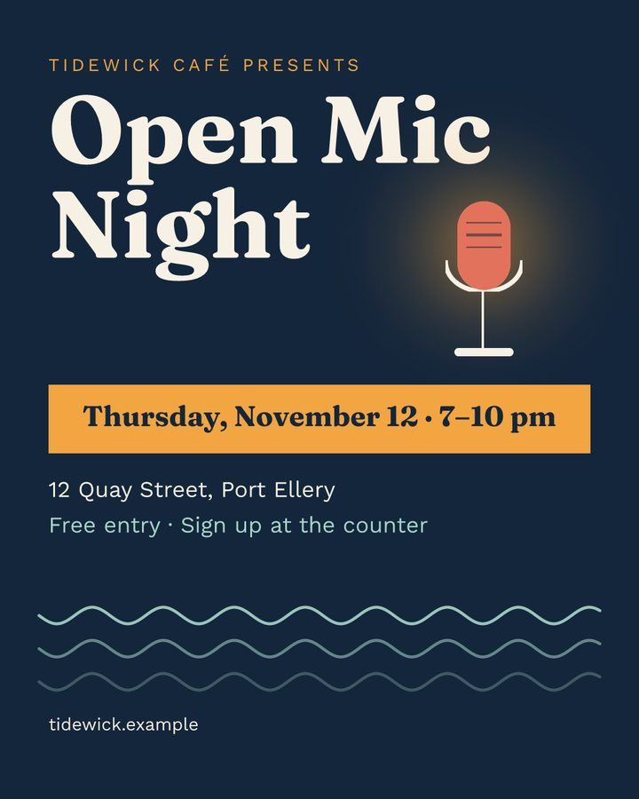</a> |  |
| **Round 2** | <a href="2026-10-12-gallery/T02/V-r2-post.jpg">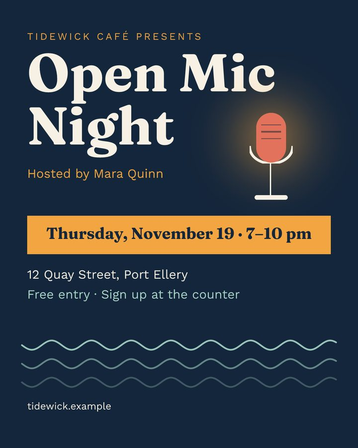</a> <a href="2026-10-12-gallery/T02/V-r2-story.jpg">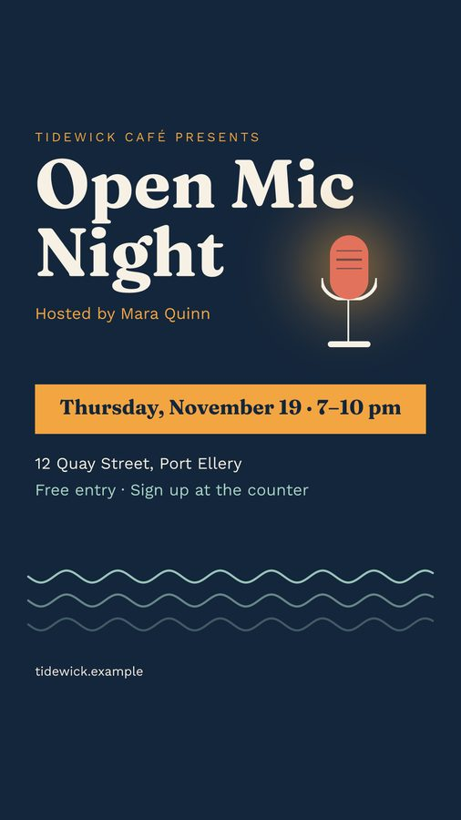</a> |  <a href="2026-10-12-gallery/T02/W-r2-story.jpg">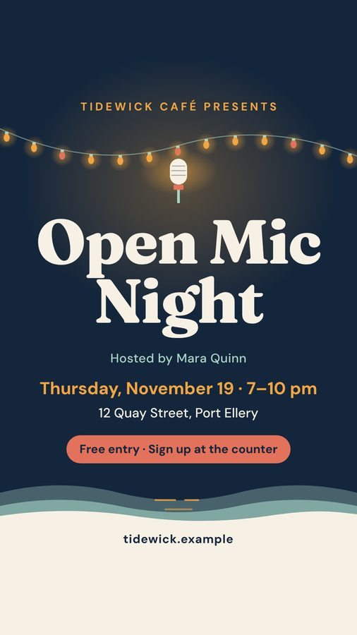</a> |

## T03 · 11 × 17 in print poster

Brief: [`T03-print-poster.md`](../evals/tool-comparison/briefs/T03-print-poster.md). Round 2 asked:
> Change the kicker to "Old Customs House Square". Replace "Live brass band" with "Fire dancers at 8 pm". Add a 1 × 1 in white square with the letters "QR" centered in it, inside the bottom-right corner of the safe area. Same print spec as before.

| Lane | Hard | Fidelity | Craft | Editability | Revision | Run date |
| --- | ---: | ---: | ---: | ---: | ---: | --- |
| V · Vixl 0.26.0 | 7/8 | 4 | 4 | 5 | 4 | 2026-10-12 |
| W · web code | 7/8 | 4 | 4 | 4 | 3 | 2026-10-05 |

| | V · Vixl 0.26.0 | W · web code |
| --- | --- | --- |
| **Round 1** | <a href="2026-10-12-gallery/T03/V-r1-poster-preview.jpg">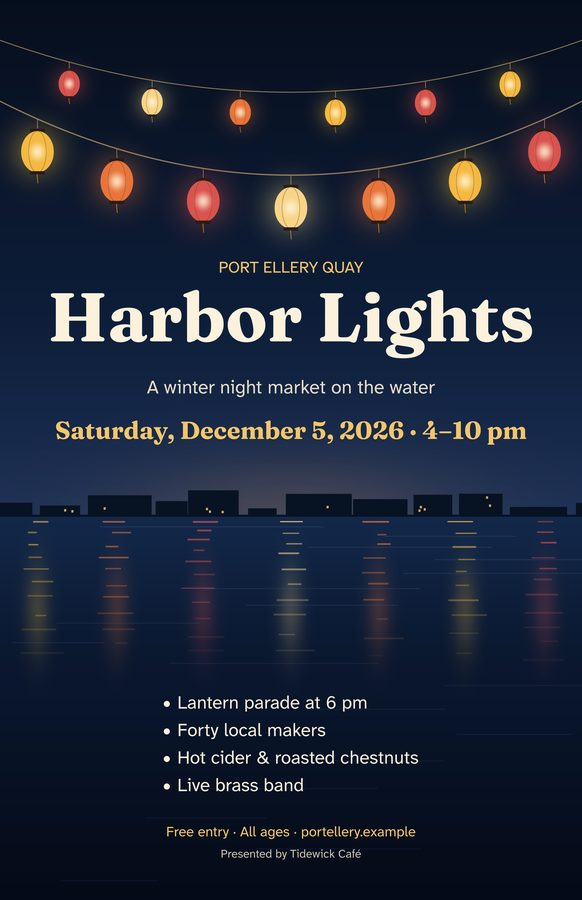</a> | <a href="2026-10-12-gallery/T03/W-r1-poster-preview.jpg">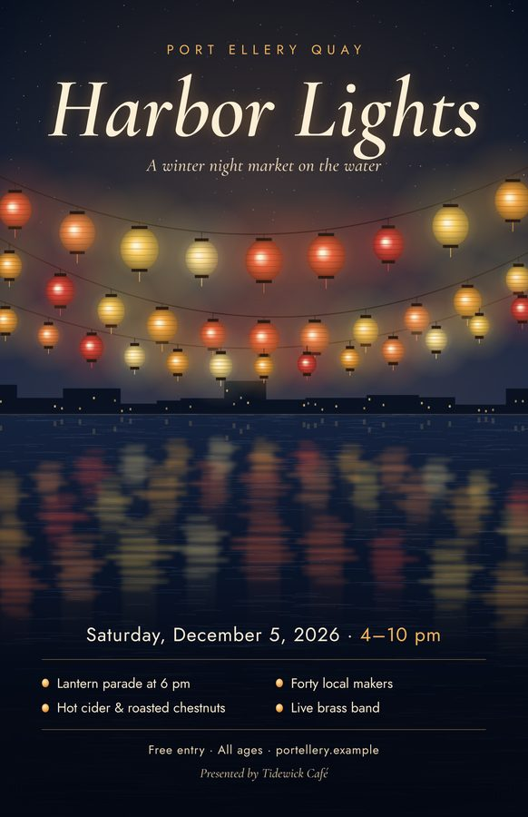</a> |
| **Round 2** | <a href="2026-10-12-gallery/T03/V-r2-poster-preview.jpg">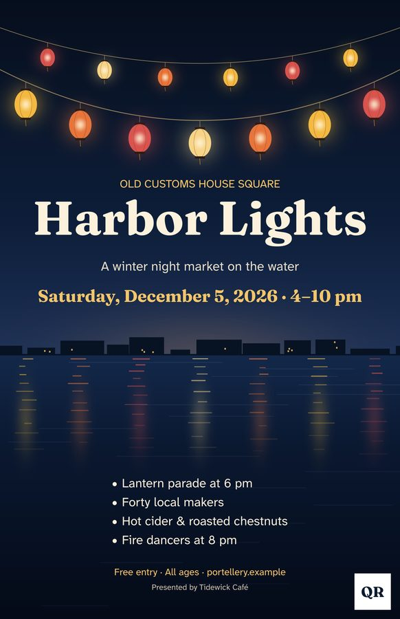</a> | <a href="2026-10-12-gallery/T03/W-r2-poster-preview.jpg">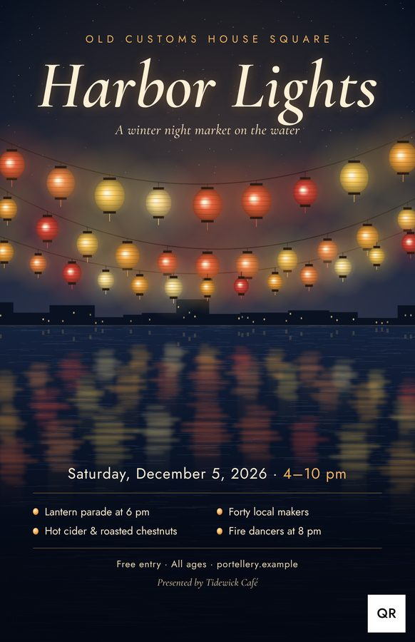</a> |

## T04 · Logo and icon kit

Brief: [`T04-logo-kit.md`](../evals/tool-comparison/briefs/T04-logo-kit.md). Round 2 asked:
> Rename the business "Tidewick & Co." and change the tagline to "Coffee · Bakery · Harbor". Update every file.

| Lane | Hard | Fidelity | Craft | Editability | Revision | Run date |
| --- | ---: | ---: | ---: | ---: | ---: | --- |
| V · Vixl 0.26.0 | 7/8 | 3 | 4 | 4 | 4 | 2026-10-12 |
| W · web code | 7/8 | 3 | 3 | 5 | 4 | 2026-10-05 |

| | V · Vixl 0.26.0 | W · web code |
| --- | --- | --- |
| **Round 1** | <a href="2026-10-12-gallery/T04/V-r1-logo-sheet.jpg">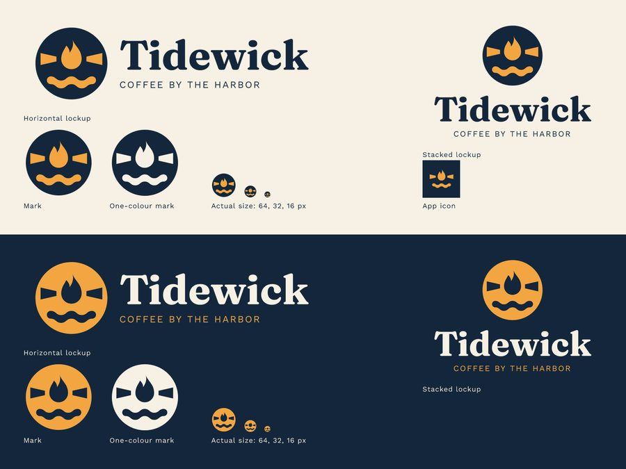</a> <a href="2026-10-12-gallery/T04/V-r1-logo-horizontal.jpg">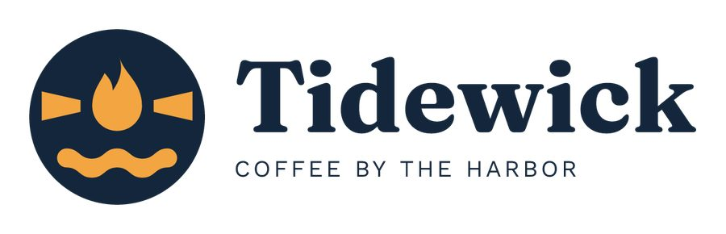</a> <a href="2026-10-12-gallery/T04/V-r1-logo-stacked.jpg">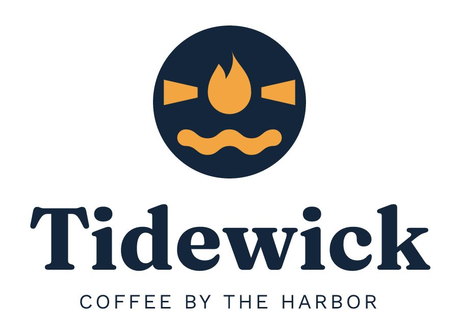</a>    | <a href="2026-10-12-gallery/T04/W-r1-logo-sheet.jpg">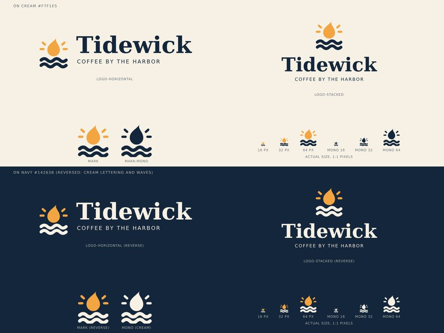</a>  <a href="2026-10-12-gallery/T04/W-r1-logo-stacked.jpg">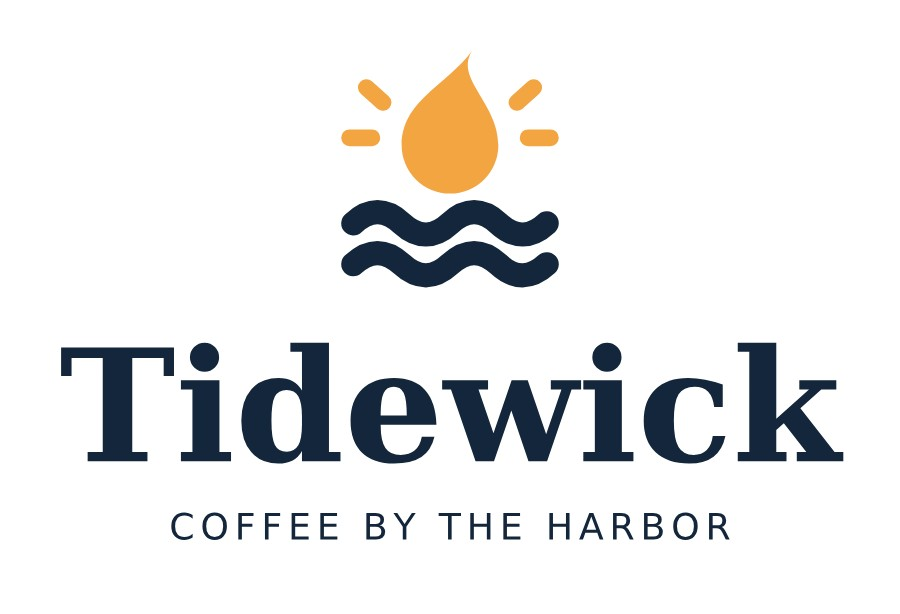</a>    |
| **Round 2** | <a href="2026-10-12-gallery/T04/V-r2-logo-sheet.jpg">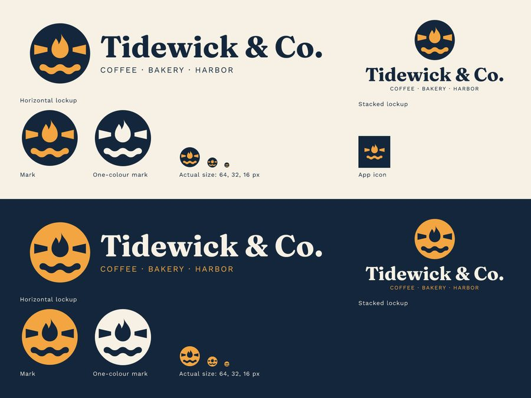</a> <a href="2026-10-12-gallery/T04/V-r2-logo-horizontal.jpg">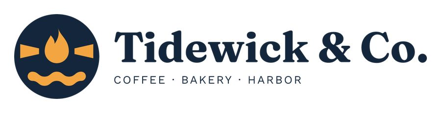</a> <a href="2026-10-12-gallery/T04/V-r2-logo-stacked.jpg">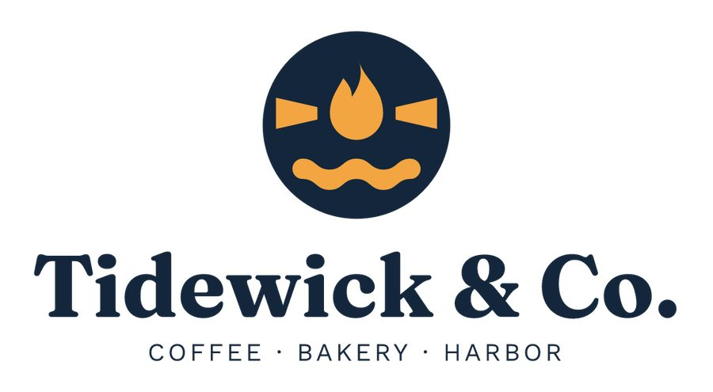</a> <a href="2026-10-12-gallery/T04/V-r2-mark.jpg">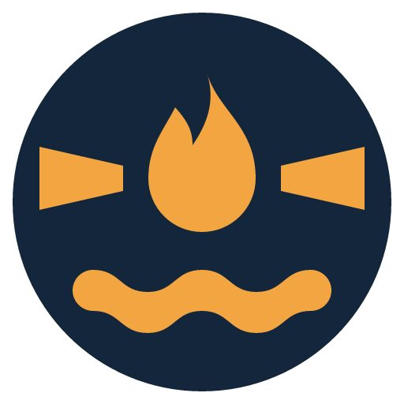</a>   | <a href="2026-10-12-gallery/T04/W-r2-logo-sheet.jpg">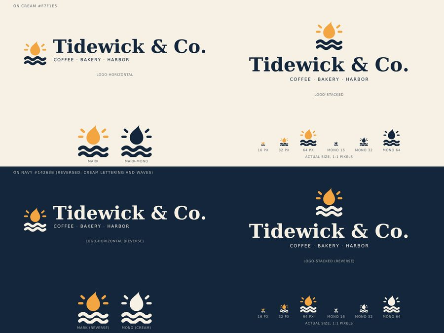</a>  <a href="2026-10-12-gallery/T04/W-r2-logo-stacked.jpg">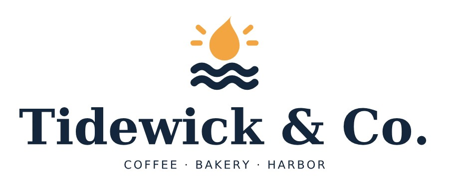</a>    |

## T05 · 6-slide deck

Brief: [`T05-slide-deck.md`](../evals/tool-comparison/briefs/T05-slide-deck.md). Round 2 asked:
> Q4 was under-counted: it is 9,250, so the year's total is 35,630 cups. Update the chart and every place the total appears. Then add a slide after "By the numbers", titled "Our regulars", with the quote “Best flat white on the coast.” — Jo, regular since 2019. Use the same style, and give it speaker notes.

| Lane | Hard | Fidelity | Craft | Editability | Revision | Run date |
| --- | ---: | ---: | ---: | ---: | ---: | --- |
| V · Vixl 0.26.0 | 7/8 | 4 | 4 | 5 | 5 | 2026-10-12 |
| C · Python | 8/8 | 5 | 3 | 5 | 5 | 2026-10-05 |

| | V · Vixl 0.26.0 | C · Python |
| --- | --- | --- |
| **Round 1** | <a href="2026-10-12-gallery/T05/V-r1-deck.jpg">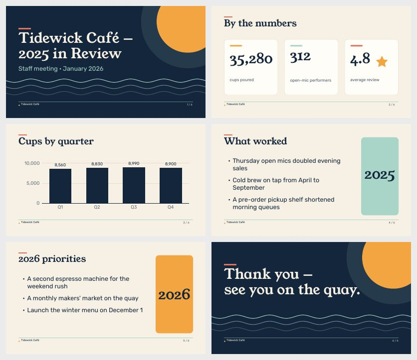</a> | <a href="2026-10-12-gallery/T05/C-r1-deck.jpg">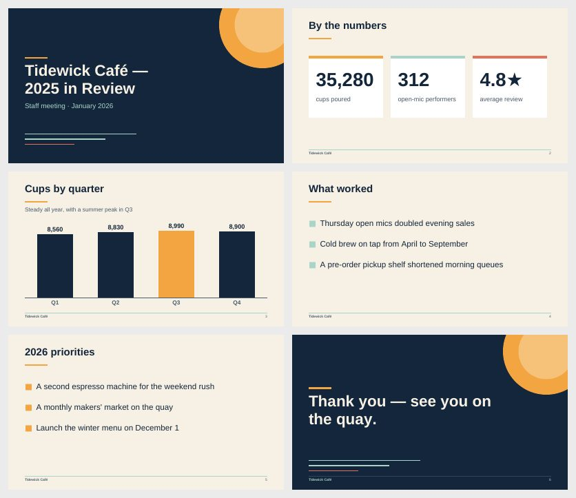</a> |
| **Round 2** | <a href="2026-10-12-gallery/T05/V-r2-deck.jpg">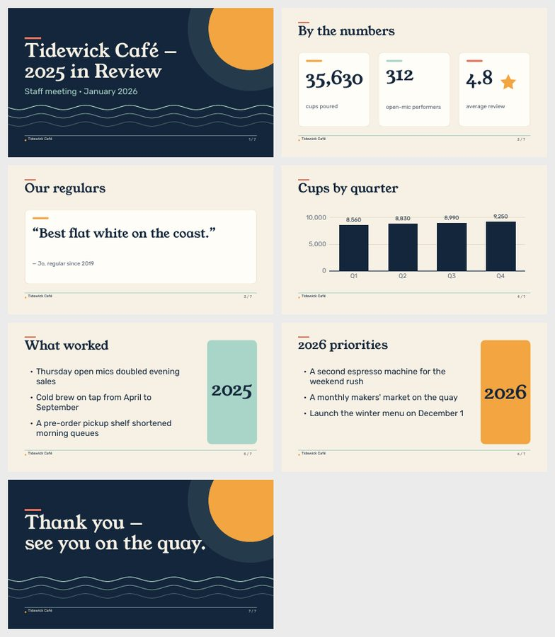</a> | <a href="2026-10-12-gallery/T05/C-r2-deck.jpg">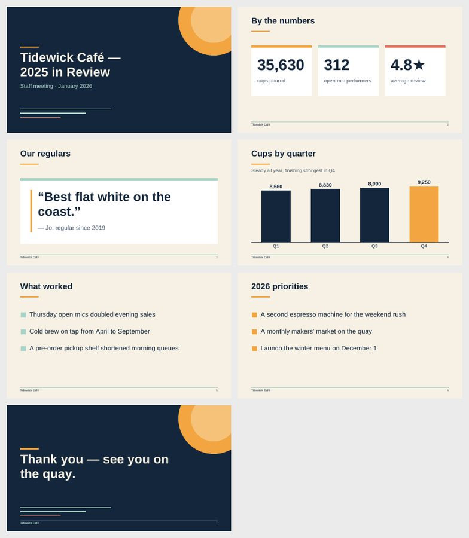</a> |

## T06 · Fillable PDF form

Brief: [`T06-fillable-form.md`](../evals/tool-comparison/briefs/T06-fillable-form.md). Round 2 asked:
> Add a required text field `instagram`, labeled "Instagram handle", right after Email. Change the slot options to 30-minute slots: 7:00–7:30, 7:30–8:00, 8:00–8:30, 8:30–9:00, 9:00–9:30, 9:30–10:00. Keep the tab order in reading order. Re-make the sample with slot 8:30–9:00 and instagram @driftwoodquartet.

| Lane | Hard | Fidelity | Craft | Editability | Revision | Run date |
| --- | ---: | ---: | ---: | ---: | ---: | --- |
| V · Vixl 0.26.0 | 7/7 | 5 | 4 | 4 | 4 | 2026-10-12 |
| C · Python | 7/7 | 5 | 4 | 5 | 5 | 2026-10-05 |

| | V · Vixl 0.26.0 | C · Python |
| --- | --- | --- |
| **Round 1** | <a href="2026-10-12-gallery/T06/V-r1-signup-form.jpg">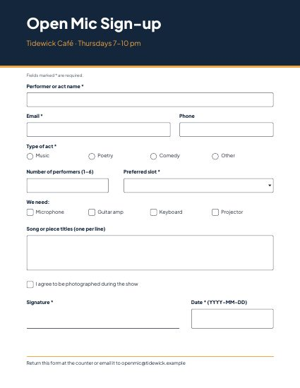</a> <a href="2026-10-12-gallery/T06/V-r1-signup-sample.jpg">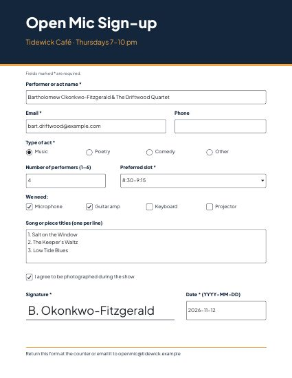</a> | <a href="2026-10-12-gallery/T06/C-r1-signup-form.jpg">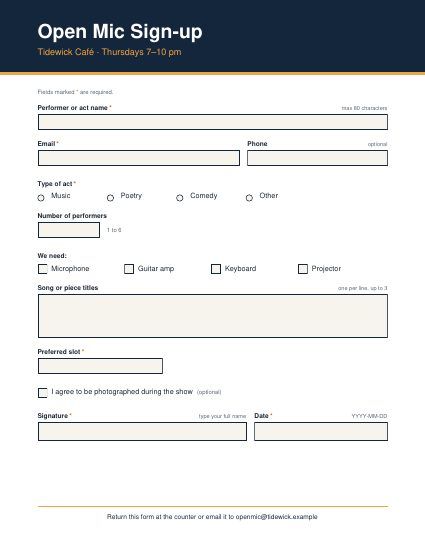</a> <a href="2026-10-12-gallery/T06/C-r1-signup-sample.jpg">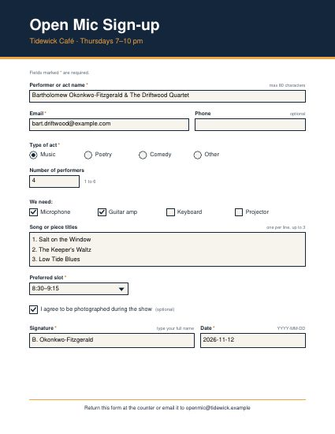</a> |
| **Round 2** | <a href="2026-10-12-gallery/T06/V-r2-signup-form.jpg">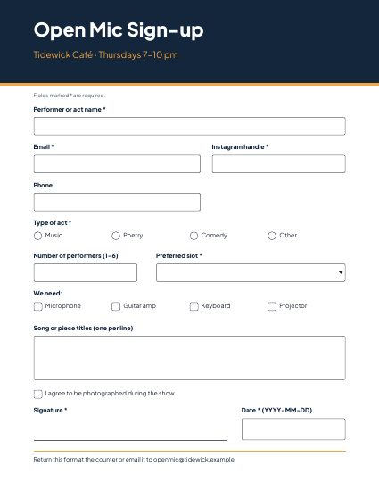</a> <a href="2026-10-12-gallery/T06/V-r2-signup-sample.jpg">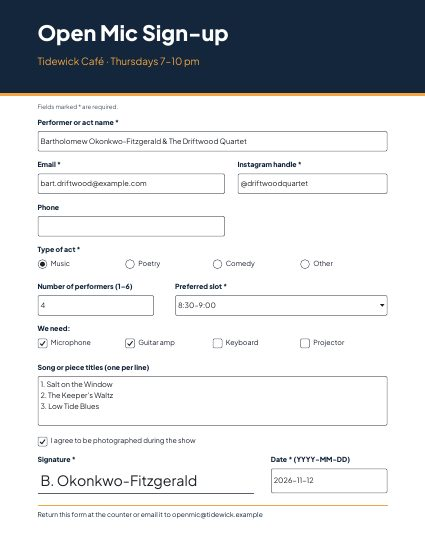</a> | <a href="2026-10-12-gallery/T06/C-r2-signup-form.jpg">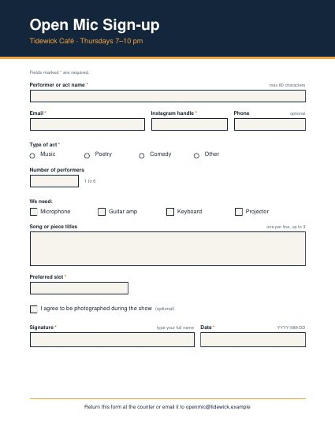</a> <a href="2026-10-12-gallery/T06/C-r2-signup-sample.jpg">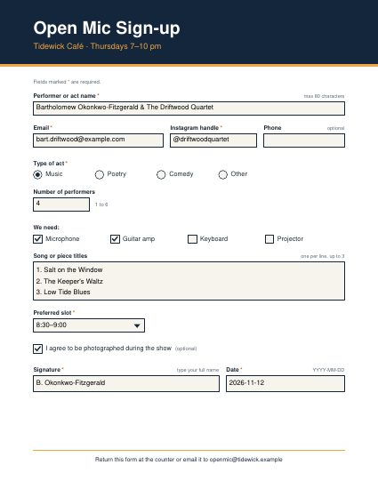</a> |

## T07 · 10 name badges from CSV

Brief: [`T07-batch-badges.md`](../evals/tool-comparison/briefs/T07-batch-badges.md). Round 2 asked:
> Add an 11th badge: Iris, Van der Berg, Speaker, Lowtide Labs. Change the Sponsor color to plum `#6b3f69`. Regenerate every badge and the print PDF.

| Lane | Hard | Fidelity | Craft | Editability | Revision | Run date |
| --- | ---: | ---: | ---: | ---: | ---: | --- |
| V · Vixl 0.26.0 | 7/7 | 5 | 4 | 5 | 5 | 2026-10-12 |
| W · web code | 7/7 | 5 | 4 | 5 | 5 | 2026-10-05 |
| C · Python | 7/7 | 5 | 3 | 5 | 5 | 2026-10-05 |

| | V · Vixl 0.26.0 | W · web code | C · Python |
| --- | --- | --- | --- |
| **Round 1** | <a href="2026-10-12-gallery/T07/V-r1-badges.jpg">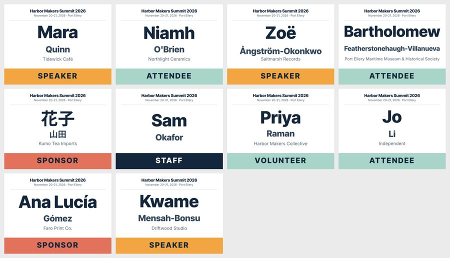</a> <a href="2026-10-12-gallery/T07/V-r1-badges-print.jpg">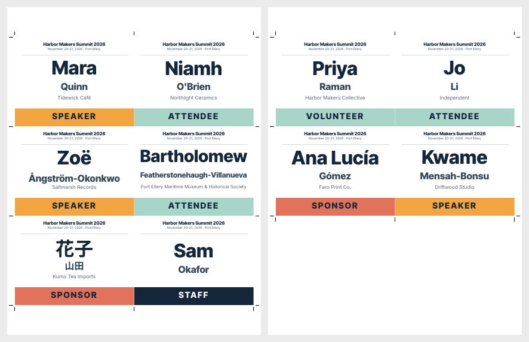</a> | <a href="2026-10-12-gallery/T07/W-r1-badges.jpg">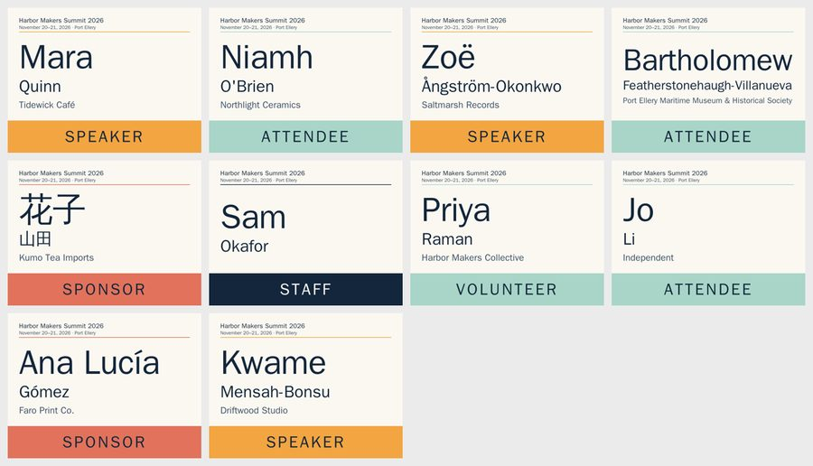</a> <a href="2026-10-12-gallery/T07/W-r1-badges-print.jpg">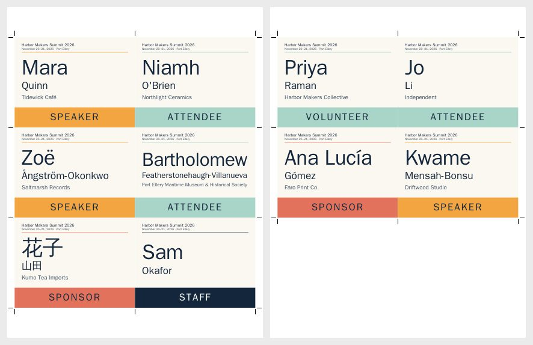</a> | <a href="2026-10-12-gallery/T07/C-r1-badges.jpg">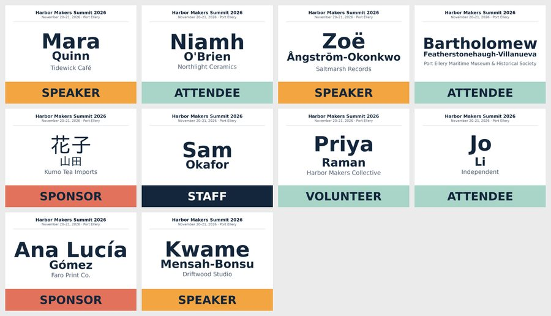</a> <a href="2026-10-12-gallery/T07/C-r1-badges-print.jpg">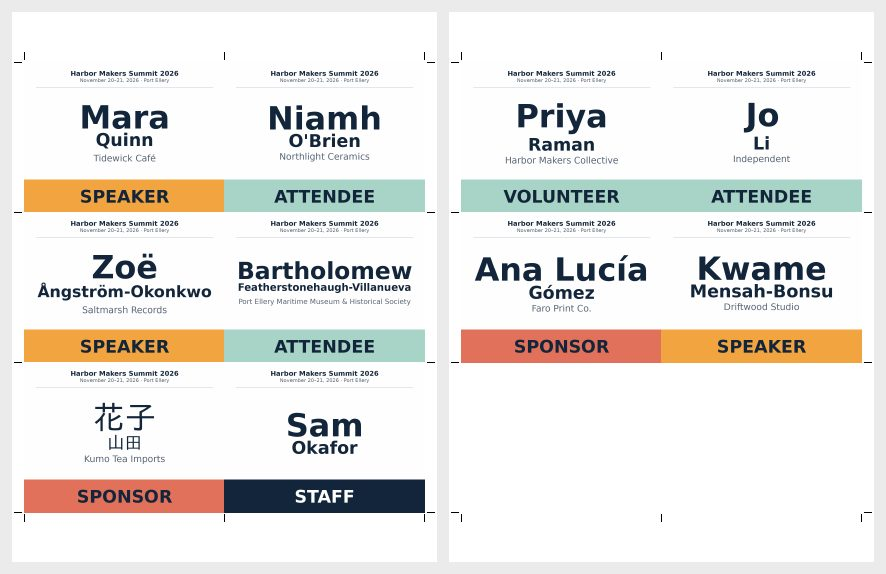</a> |
| **Round 2** | <a href="2026-10-12-gallery/T07/V-r2-badges.jpg">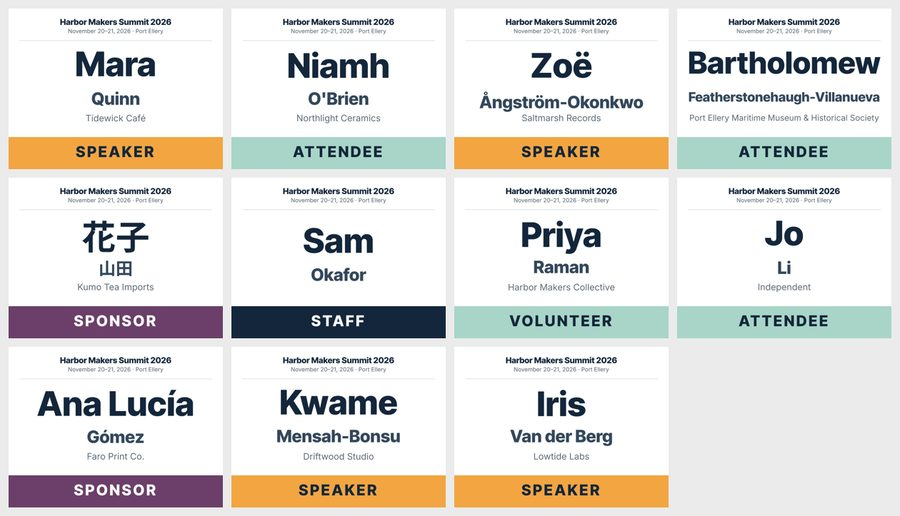</a> <a href="2026-10-12-gallery/T07/V-r2-badges-print.jpg">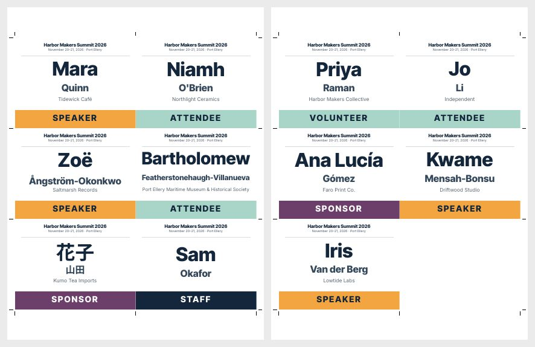</a> | <a href="2026-10-12-gallery/T07/W-r2-badges.jpg">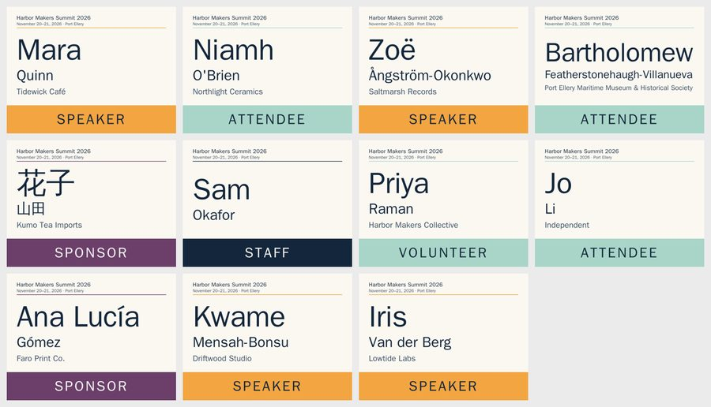</a> <a href="2026-10-12-gallery/T07/W-r2-badges-print.jpg">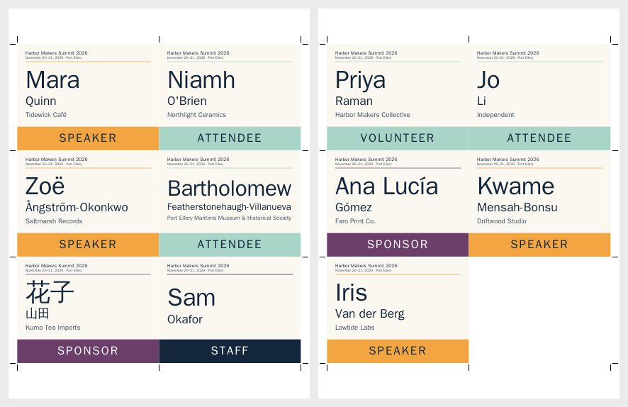</a> | <a href="2026-10-12-gallery/T07/C-r2-badges.jpg">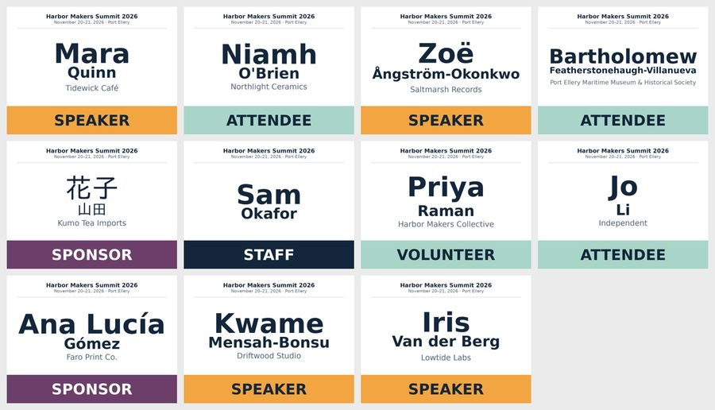</a> <a href="2026-10-12-gallery/T07/C-r2-badges-print.jpg">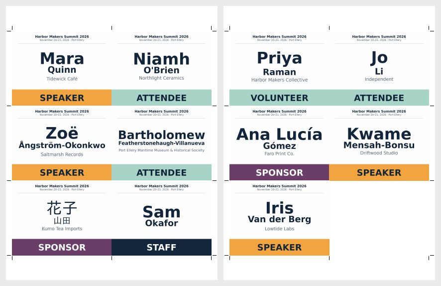</a> |

## T08 · Data infographic

Brief: [`T08-infographic.md`](../evals/tool-comparison/briefs/T08-infographic.md). Round 2 asked:
> December's numbers were wrong. The correct values are flat_white 1480, drip 1120, cold_brew 90, tea 640. Update every chart and number, and change tea's color to plum `#6b3f69`.

| Lane | Hard | Fidelity | Craft | Editability | Revision | Run date |
| --- | ---: | ---: | ---: | ---: | ---: | --- |
| V · Vixl 0.26.0 | 5/5 | 5 | 4 | 5 | 4 | 2026-10-12 |
| W · web code | 5/5 | 5 | 5 | 5 | 4 | 2026-10-05 |
| C · Python | 5/5 | 5 | 4 | 5 | 4 | 2026-10-05 |

| | V · Vixl 0.26.0 | W · web code | C · Python |
| --- | --- | --- | --- |
| **Round 1** | <a href="2026-10-12-gallery/T08/V-r1-infographic.jpg">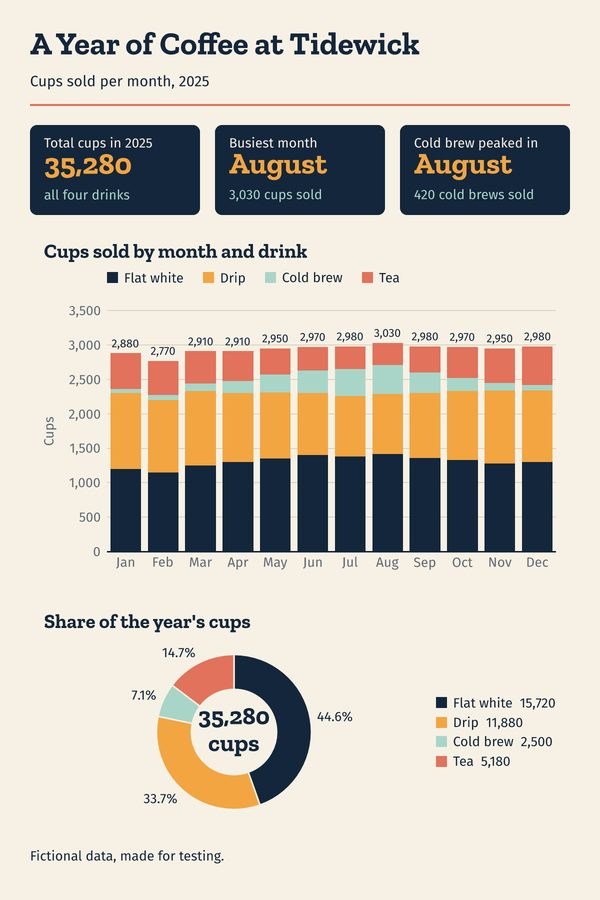</a> | <a href="2026-10-12-gallery/T08/W-r1-infographic.jpg">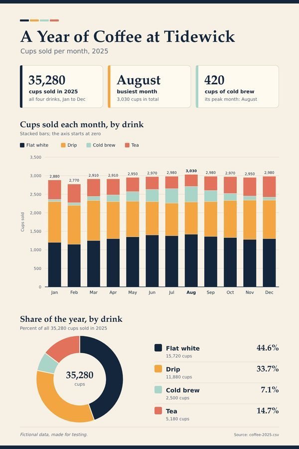</a> | <a href="2026-10-12-gallery/T08/C-r1-infographic.jpg">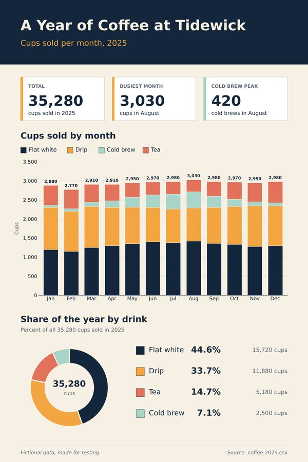</a> |
| **Round 2** | <a href="2026-10-12-gallery/T08/V-r2-infographic.jpg">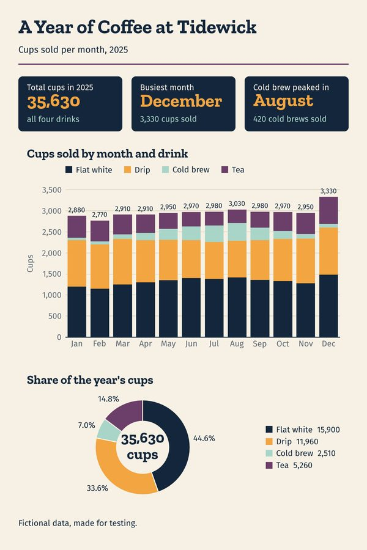</a> | <a href="2026-10-12-gallery/T08/W-r2-infographic.jpg">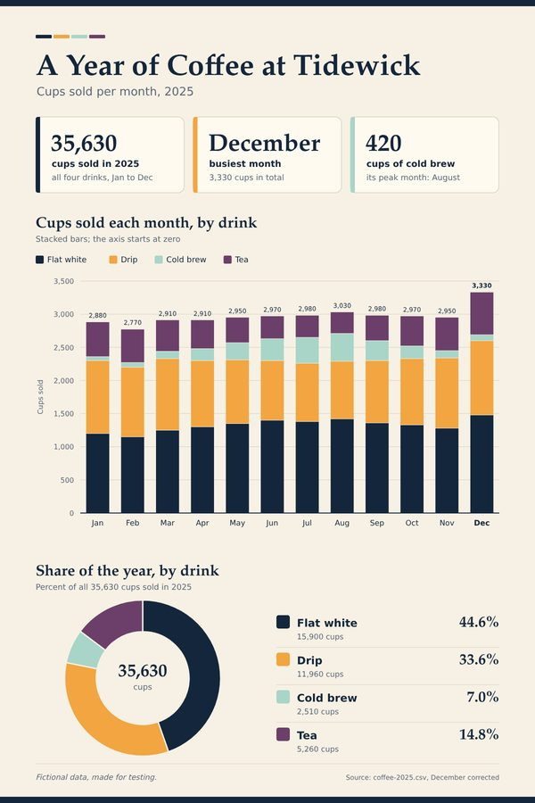</a> |  |

## T09 · One campaign in 6 sizes

Brief: [`T09-multi-size-campaign.md`](../evals/tool-comparison/briefs/T09-multi-size-campaign.md). Round 2 asked:
> Change the headline to "Winter Menu: now pouring" and replace "Smoked maple latte" with "Spiced honey cortado" in all six.

| Lane | Hard | Fidelity | Craft | Editability | Revision | Run date |
| --- | ---: | ---: | ---: | ---: | ---: | --- |
| V · Vixl 0.26.0 | 6/6 | 5 | 4 | 4 | 4 | 2026-10-12 |
| W · web code | 6/6 | 5 | 3 | 5 | 4 | 2026-10-05 |

| | V · Vixl 0.26.0 | W · web code |
| --- | --- | --- |
| **Round 1** | <a href="2026-10-12-gallery/T09/V-r1-instagram-square.jpg">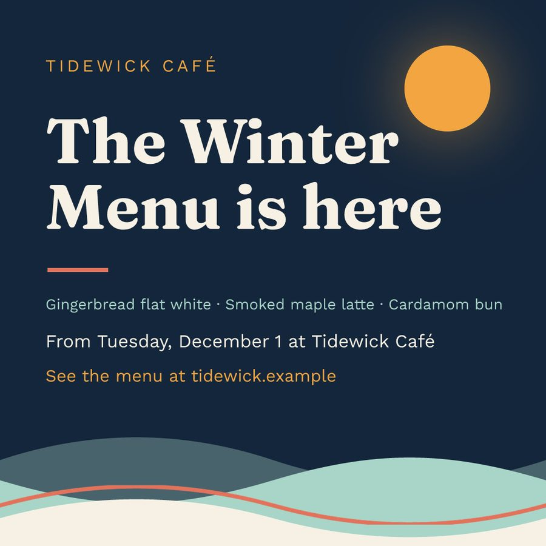</a> <a href="2026-10-12-gallery/T09/V-r1-instagram-story.jpg">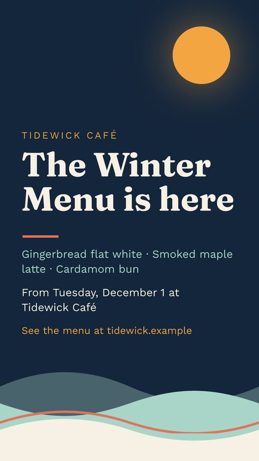</a>     |       |
| **Round 2** |       |       |

## T10 · Photo correction

Brief: [`T10-photo-edit.md`](../evals/tool-comparison/briefs/T10-photo-edit.md). Round 2 asked:
> Make it a little warmer, with slightly less contrast, and change the caption to "Port Ellery, October evening". Apply this to all three files.

| Lane | Hard | Fidelity | Craft | Editability | Revision | Run date |
| --- | ---: | ---: | ---: | ---: | ---: | --- |
| V · Vixl 0.26.0 | 6/6 | 4 | 3 | 5 | 5 | 2026-10-12 |
| C · Python | 6/6 | 4 | 3 | 5 | 5 | 2026-10-05 |
| T · CLI tools | 6/6 | 5 | 4 | 5 | 4.5 | 2026-10-05 |

| | V · Vixl 0.26.0 | C · Python | T · CLI tools |
| --- | --- | --- | --- |
| **Round 1** |    |    |    |
| **Round 2** |    |    |    |

## T11 · Sketch to clean art

Brief: [`T11-hand-drawing.md`](../evals/tool-comparison/briefs/T11-hand-drawing.md). Round 2 asked:
> Make the roof red `#c0392b` instead of coral, and add a chimney on the right side of the roof, drawn with the same line weight and character as the rest.

| Lane | Hard | Fidelity | Craft | Editability | Revision | Run date |
| --- | ---: | ---: | ---: | ---: | ---: | --- |
| V · Vixl 0.26.0 | 4/5 | 4 | 3 | 5 | 5 | 2026-10-12 |
| C · Python | 4/5 | 4 | 4 | 5 | 5 | 2026-10-05 |
| T · CLI tools | 4/5 | 4 | 4 | 4 | 5 | 2026-10-05 |

| | V · Vixl 0.26.0 | C · Python | T · CLI tools |
| --- | --- | --- | --- |
| **Round 1** |    |    |    |
| **Round 2** |    |    |    |

## T12 · 6 s animated intro

Brief: [`T12-motion-intro.md`](../evals/tool-comparison/briefs/T12-motion-intro.md). Round 2 asked:
> Make it 8 seconds: slow the beam to half speed, change the tagline to "Open daily from 7 am", and extend the final hold to 3 seconds. Same files and specs otherwise.

| Lane | Hard | Fidelity | Craft | Editability | Revision | Run date |
| --- | ---: | ---: | ---: | ---: | ---: | --- |
| V · Vixl 0.26.0 | 5/5 | 5 | 4 | 5 | 5 | 2026-10-12 |
| W · web code | 5/5 | 4 | 4 | 5 | 5 | 2026-10-05 |

| | V · Vixl 0.26.0 | W · web code |
| --- | --- | --- |
| **Round 1** |   |   |
| **Round 2** |   |   |

## T13 · Pixel-art sprite

Brief: [`T13-pixel-sprite.md`](../evals/tool-comparison/briefs/T13-pixel-sprite.md). Round 2 asked:
> Make the raincoat red, and add a 2-frame "wave" animation (250 ms per frame) after the walk frames: the sheet becomes 256 × 32, the JSON gains the frames, and add `keeper-wave.gif`.

| Lane | Hard | Fidelity | Craft | Editability | Revision | Run date |
| --- | ---: | ---: | ---: | ---: | ---: | --- |
| V · Vixl 0.26.0 | 5/5 | 5 | 4 | 5 | 5 | 2026-10-12 |
| C · Python | 5/5 | 5 | 4 | 5 | 5 | 2026-10-05 |

| | V · Vixl 0.26.0 | C · Python |
| --- | --- | --- |
| **Round 1** |    |    |
| **Round 2** |     |     |

## T14 · Lyric video

Brief: [`T14-lyric-video.md`](../evals/tool-comparison/briefs/T14-lyric-video.md). Round 2 asked:
> Shift every lyric 0.25 s earlier (the title card still starts at 0), and make chorus lines 25 % larger.

| Lane | Hard | Fidelity | Craft | Editability | Revision | Run date |
| --- | ---: | ---: | ---: | ---: | ---: | --- |
| V · Vixl 0.26.0 | 5/5 | 5 | 4 | 5 | 4 | 2026-10-12 |
| T · CLI tools | 4/5 | 4 | 2 | 4 | 5 | 2026-10-05 |

| | V · Vixl 0.26.0 | T · CLI tools |
| --- | --- | --- |
| **Round 1** |  |  |
| **Round 2** |  |  |

## T15 · Seamless pattern and mug wrap

Brief: [`T15-seamless-pattern.md`](../evals/tool-comparison/briefs/T15-seamless-pattern.md). Round 2 asked:
> Make all the shells amber, and reduce the number of motifs by about a third. Regenerate every file.

| Lane | Hard | Fidelity | Craft | Editability | Revision | Run date |
| --- | ---: | ---: | ---: | ---: | ---: | --- |
| V · Vixl 0.26.0 | 4/4 | 5 | 3 | 3 | 3 | 2026-10-12 |
| W · web code | 4/4 | 4 | 3 | 4 | 3 | 2026-10-05 |
| C · Python | 4/4 | 4 | 4 | 3 | 3 | 2026-10-05 |

| | V · Vixl 0.26.0 | W · web code | C · Python |
| --- | --- | --- | --- |
| **Round 1** |    |    |    |
| **Round 2** |    |    |    |

## T16 · Text-heavy menu

Brief: [`T16-menu.md`](../evals/tool-comparison/briefs/T16-menu.md). Round 2 asked:
> Raise every coffee price by $0.25, remove "Drip refill", and add a note under the Coffee section: "Oat milk +$0.75".

| Lane | Hard | Fidelity | Craft | Editability | Revision | Run date |
| --- | ---: | ---: | ---: | ---: | ---: | --- |
| V · Vixl 0.26.0 | 6/6 | 5 | 4 | 5 | 5 | 2026-10-12 |
| W · web code | 6/6 | 4 | 4 | 5 | 5 | 2026-10-05 |

| | V · Vixl 0.26.0 | W · web code |
| --- | --- | --- |
| **Round 1** |  |  |
| **Round 2** |  |  |

