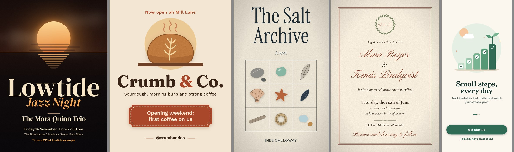

# Craft check · 2026-10-13 · Vixl 0.26.0

Eight new briefs ([`../briefs/`](../briefs/)), each made by a fresh agent through Vixl's MCP tools under the
tool-comparison V-lane rule, then judged on its own by two independent judges with
[`../JUDGE.md`](../JUDGE.md). Nothing is compared with anything else. Scores are in `scores.json`.

## Scores (mean of two judges)

| Piece | Craft | Hierarchy | Spacing | Type | Colour | Finish | Motif | Fit |
| --- | ---: | ---: | ---: | ---: | ---: | ---: | ---: | ---: |
| C01 jazz poster | 4 | 5 | 4 | 4 | 5 | 4 | 3 | 4.5 |
| C02 bakery post | 4 | 5 | 4 | 4 | 5 | 3 | 3.5 | 4 |
| C03 book cover | 3.5 | 4.5 | 3.5 | 4 | 4 | 3.5 | 3 | 3.5 |
| C04 keynote slide | 4 | 5 | 4 | 4 | 4 | 4 | 3 | 5 |
| C05 infographic | 4 | 5 | 4 | 4.5 | 4.5 | 5 | – | 4 |
| C06 wedding invitation | 3 | 3 | 3 | 3 | 4 | 4 | 3 | 4 |
| C07 onboarding screen | 4 | 5 | 3 | 4 | 5 | 4 | 4 | 5 |
| C08 podcast cover | 4 | 5 | 4 | 4 | 5 | 4 | 4 | 4 |
| **Mean** | **3.81** | **4.69** | **3.69** | **3.94** | **4.56** | **3.94** | **3.36** | **4.25** |

All 16 verdicts are "publish after fixes": no piece was ready as is, and none needed a redo.

## Fixes the judges asked for, by how many pieces they hit

| Fix | Pieces |
| --- | --- |
| Uneven vertical rhythm or a dead band (major on C07) | C01, C03, C04, C05, C06, C07, C08 |
| Generic or stock motif, or illustrations in mixed styles (major on C01, C03) | C01, C02, C03, C04 |
| Muddy glows and drop shadows | C01, C04, C07, C08 |
| Secondary text too small or light at its real use size | C01, C03, C04, C05, C08 |
| Drawing defects in illustrations (cut-off shapes, unjoined parts, broken dashes) | C02, C03, C07 |
| Type choices: a third face, a script used twice | C06 |

## What the making agents ran into

- **The shared active document (five of eight agents).** One MCP server serves several clients with one
  active document. A call without `document=` went to whichever document another agent last used:
  two were rejected, two added unused fonts to another file, and one added five layers and three
  swatches to another agent's infographic, which that agent had to find and delete.
- **Letter-spacing draws wider than it measures** in downscaled previews (C03) and when centring (C06).
- **Script glyphs that overhang their box are clipped** (C06).
- **No way to delete a swatch** (C05) and **no opacity on `pen`** (C02).
