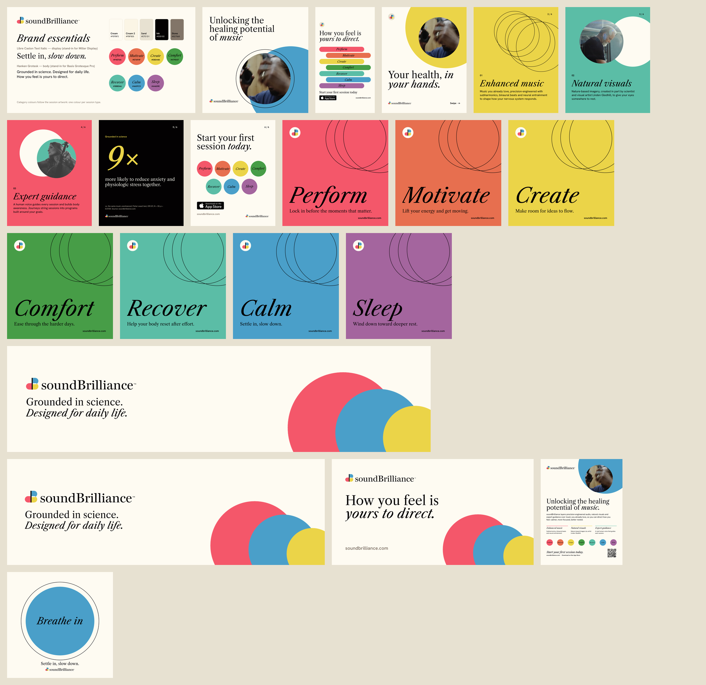

# soundBrilliance marketing package

A launch kit for [soundBrilliance](https://www.soundbrilliance.com/), the app that layers enhanced audio, natural
visuals and expert guidance over music people already love. Every piece is built with Vixl by
[`build.py`](build.py) and ships as an editable `.vixl` master next to its exports.



| Folder | Pieces | Formats |
| --- | --- | --- |
| `output/00-brand` | Brand essentials: logo, core palette, the seven category colours, type | PNG, PDF |
| `output/01-social` | Instagram hero post (1080×1080), Instagram/Facebook story (1080×1920) | PNG, JPG |
| `output/02-carousel` | Six-slide 4:5 carousel: promise, enhanced music, natural visuals, expert guidance, the 9× result, call to action | PNG |
| `output/03-session-cards` | One 1080×1080 card per session type: Perform, Motivate, Create, Comfort, Recover, Calm, Sleep | PNG |
| `output/04-banners` | LinkedIn banner (1584×396), X header (1500×500), Open Graph link image (1200×630) | PNG |
| `output/05-print` | US Letter flyer for clinics, studios and gyms, with a QR code to the site | PDF (vector), PNG proof |
| `output/06-motion` | 8-second "Breathe in / Breathe out" loop | MP4, GIF, PNG poster |

## Brand inputs

Taken from soundbrilliance.com (stored in `source/`):

- **Logo**: the site's outlined lockup SVG, imported as editable vector paths (`logo-lockup.svg`, plus the B mark alone
  in `logo-mark.svg`); on dark backgrounds the wordmark switches to cream.
- **Palette**: the site stylesheet's cream `#FEFBF2`, ink `#030102`, sand `#E7E1D1`, stone `#827568` and the category
  colours red `#F4576A`, orange `#E76F4F`, yellow `#EBD448`, green `#479D47`, teal `#5BBDA6`, blue `#4A9FC9`, purple `#A4659E`.
- **Imagery**: film stills and session artwork from the site.
- **Type**: the site uses Miller Display and Basis Grotesque Pro (licensed). The package uses the open fonts
  Libre Caslon Text (italic for display) and Hanken Grotesk. To switch to the licensed fonts, register them
  in `doc()` in `build.py` and rebuild.

## Copy to confirm with the client

- Headlines are the site's own lines: "Unlocking the healing potential of music", "How you feel is yours to direct",
  "Grounded in science. Designed for daily life.", "Start your first session today".
- The one-line descriptions on the session cards are **draft copy** written for this package (see `CATEGORIES` in
  `build.py`). Have them reviewed, as health-related wording.
- The 9× result (carousel slide 5) comes from the site and is printed with its footnote: Fisher exact test,
  OR 8.9, N = 33, p = 0.0104. Keep the footnote wherever the number appears, since the sample is small.

## Rebuild

```bash
pip install -e .                      # from the repo root
python examples/soundbrilliance/build.py            # everything
python examples/soundbrilliance/build.py cards flyer  # some pieces
```

Each piece must pass Vixl's design checks (contrast, bounds, safe area, overlap) and its own rule suite (canvas
size, font budget, headline contrast, even spacing, QR placement) before anything is exported. The reports are
kept as `*.check.json`. MP4 export needs `ffmpeg` on PATH.
