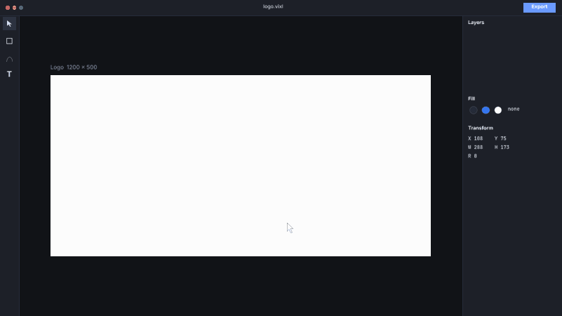
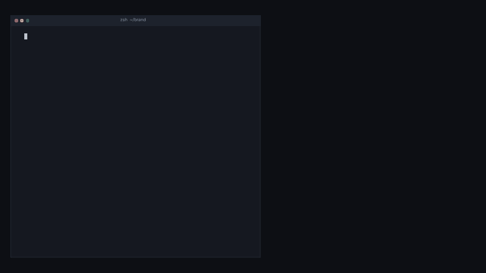
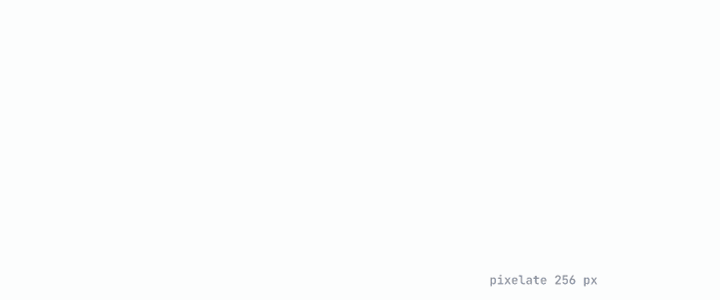
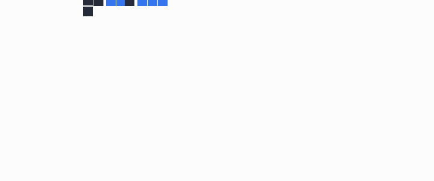
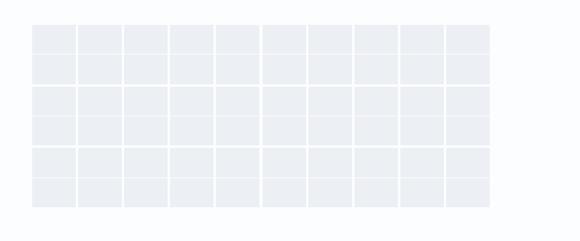
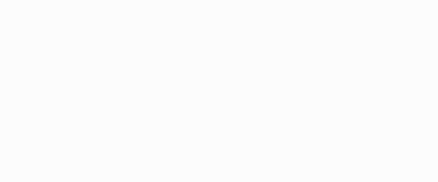
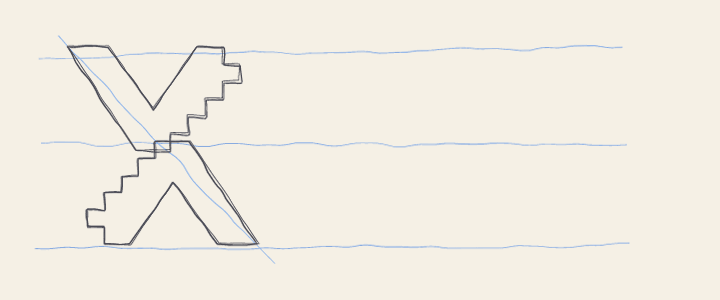
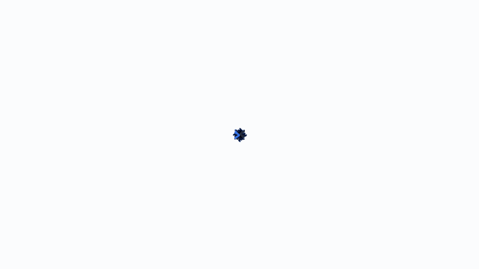

# Logo builds: nineteen ways to assemble the Vixl mark

Nineteen animations that build the [Digital Shift logo](../../assets/brand/digital-shift/START-HERE.md) out of nothing or out of something simpler. Each one opens the editable master `horizontal-color.vixl`, adds keyframes and some temporary helper layers, and ends on the exact logo, which then holds for 1.4 s before the loop restarts. Builds 01–07 are pure motion. Builds 08–13 show off what Vixl itself does: an editor session, the CLI, layers, effects and pixels. Builds 14–19 lean on clipping, hand-drawn imperfection, synthesized sound and a night-sky colourway.

Rebuild everything with `python explorations/11-logo-animations/build.py` (about 10 minutes, most of it in *Deep zoom*), or rebuild a subset by name: `... build.py 03 glitch`. Each build writes a GIF at most 800 px wide, a full-size MP4 and a contact sheet of the build phase to `output/`. Builds 01–07 live in `build.py`, 08–13 in `build_more.py` and 14–19 in `build_extra.py`. The UI text in 08 and 09 is too small to read in the GIFs, so watch the MP4s for those.

| | Build | Technique |
| --- | --- | --- |
|  | **01 Slide and lock** (2.8 s) | The V's drop in from the top and bottom (`translate-y`, ease-out-quart), and the grouped mark squashes to 94% when they lock. The detached pixels shoot out of the stair corners with `ease-out-back`, and the wordmark slides in letter by letter (`text-animate slide-left`). |
|  | **02 Pixel swarm** (3.8 s) | The V's are cut into 14.4 px cells (half the stair step, so the grid follows the stairs) with a point-in-polygon test. About 220 cells fly in from random directions, spinning as they come, then cross-fade into the vector V's. |
|  | **03 Ripple pop** (3.4 s) | The same cells pop in (`scale` 0 → 1, `ease-out-back`), each delayed by its distance from where the V's meet, so the mark ripples outward. The pixels pop with `elastic-out`, then each letter of the wordmark pops in. |
|  | **04 Break apart** (3.8 s) | Two plain offset bars grow in (`scale-x` on a group with a left or right pivot), and a cover wipe turns the lower bar blue. Everything outside the V's then cracks off, with 2 × 2 chunks where possible, and falls away from the centre line, so the logo is carved out of the bars. |
|  | **05 Draw-on** (3.6 s) | Outline copies of the V's trace themselves (`trim_end` 0 → 100), the fills flood in under them, and the wordmark types itself out (`text-animate typewriter`). |
|  | **06 Seed grow** (3.6 s) | A single pixel pops in, pulses and splits into a charcoal half and a blue half. Each half moves to its V's tip, where the V stretches up (`scale-y`) and then unfolds sideways (`scale-x`, ease-out-back) about a pivot on the tip. |
|  | **07 Glitch shift** (3.4 s) | A nod to the kit's "Digital Shift" name. Cyan and magenta `multiply` ghosts of each part jitter on `hold` keys every other frame, with offsets that shrink to zero, and they flicker until each part snaps into register. |

## Showing off the app

| | Build | Technique |
| --- | --- | --- |
|  | **08 Design app** (14.3 s, 1920 × 1080) | An editor drawn with Vixl shapes and text: toolbar, layers panel, fill swatches, transform readout, artboard. A cursor picks the pen tool and clicks the upper V's 17 anchors while its outline follows (`trim_end` keyed to the outline length at each click), then fills it from the charcoal swatch. Next it duplicates the V, swings the copy round 180° (the lower V is the upper V turned over) and drags it into place. It recolours the copy blue, drags out the six pixels with the rectangle tool, types the name with the text tool and clicks Export. The layer rows, hex value, selection box, size tag and X/Y/W/H/R readouts all follow along on `hold` keys, `text` keys included. |
|  | **09 Terminal** (16.1 s, 1920 × 1080) | Ten real `vixl` CLI commands type themselves into a terminal, and each one's effect lands in a preview window as its output line appears: `new`, `shape path`, `duplicate`, `rotate`, `shape --fill`, `move`, `shape rectangle`, `font install`, `text add` and `export`. The commands were run as shown (with the 17-point path written out in full) and rebuild the master. The wordmark's ink box matches it exactly, and the export is the 3,787-byte, vector-only SVG named in the output. Outputs are condensed from the JSON. The typing is `text` keys on one track per line, and the caret follows a 0.6 em monospace advance. |
|  | **10 Layer stack** (5.1 s) | The logo's four layers (the two V's, the pixels and the wordmark) drop one by one onto glass plates in an exploded isometric stack. The stack then collapses, untilts and flattens into the logo while the backdrop fades to white. Each plate is a group (`rotation` −38°) nested in a group (`scale-y` 0.52), so the squash happens in screen space. All plates are the same size, so all planes share one centre. |
|  | **11 Depixelate** (5.8 s) | A `pixelate` effect on the grouped logo steps down from 256 px blocks to 1 (`effect:1` keys with `hold` easing), and a monospace readout counts the block size down with stepped `text` keys. It ends on "vector 1:1". |
|  | **12 Deep zoom** (5.5 s, 1600 × 900) | The frame opens on one 13 px pixel, filled by it at 60×, and pulls out to the whole logo while faint background pixels zoom more slowly for parallax. Then the wordmark waves. |
|  | **13 Block stack** (4.6 s) | The V's are cut into 28.8 px blocks (one stair step), grouped greedily into four-block pieces and dropped Tetris-style with `bounce-out`, bottom rows first. The blocks snap to the vector V's, then the pixels pop in and the letters drop and bounce. |

## Clipping, sketches, sound and night sky

| | Build | Technique |
| --- | --- | --- |
|  | **14 Split-flap** (4.0 s) | A departures board of 30 tiles. Each tile holds a slice of a flattened raster of the logo (`merge-layers`), clipped to the tile (`clip`), under a "junk" card. Each tile flips (`scale-y` 1 → 0 → 1) three to six times through random colours, on `hold` keys that switch at mid-flip, before it lands on its slice. The tiles then fade over the vector logo, so the gaps close up. |
|  | **15 Liquid fill** (5.1 s) | Pale "glass" copies of the V's and the wordmark fill with a wavy liquid layer clipped to each one. The liquid rises while its surface travels sideways one wavelength every 600 ms, and clipped bubbles rise through it. The lower V fills first, then the upper V, then the name; the loose pixels drip in last with `bounce-out`. |
|  | **16 Napkin sketch** (6.0 s) | On paper-coloured ground, light blue pencil guides rule themselves in, two wobbly pencil passes trace each V (`irregular`, then `trim_end`), and "Vixl" is handwritten in Caveat. The shapes are inked in slightly wobbly, then everything snaps to the crisp vector logo as the paper turns white. |
|  | **17 Beat build** (5.8 s, sound) | The logo lands on a synthesized 120 bpm beat. A two-beat hi-hat count-in shows as metronome dots, then the upper V drops on a kick and the lower V rises on the snare. The six pixels pop on bell sixteenths, the letters pop on a piano arpeggio, and a final chord and crash land with a bounce. Every kick squashes the mark and flashes the background. All the sound comes from `audio-track` synths (`kick`, `snare`, `hihat`, `bell`, `piano`, `noise`), and the MP4 carries the mix (peak 0.72). Play the MP4; the GIF is silent. |
|  | **18 Kaleidoscope** (5.2 s, 1600 × 900) | Eight copies of the mark, rotated 45° apart and blended with `multiply`, bloom into a spinning mandala in the middle of the frame. They then fold onto one another into a single mark, which slides to its place as the name slides in. |
|  | **19 Fireworks** (4.6 s, 1600 × 900) | In the kit's reverse colourway (white and `#6A9AFF`) on a night sky, three rockets climb with fading trails and burst into rings of sparks that slow down, droop and fade. The last burst leaves the mark behind; its pixels scatter out of the flash, and the name sparkles in from gold. |

## Notes

- **The timeline has a track limit.** A timeline holds at most 1,024 tracks (`MAX_TRACKS`). The first version of *Break apart* gave each of its 480 cells four tracks plus a colour track and failed at operation 1024. The fix uses fewer animated things: debris breaks off in 2 × 2 chunks, one cover layer replaces 240 per-cell `fill` animations, and the two slab groups fade out instead of their cells. Plan a particle-style build around this limit, or use `particles`.
- **Cells overlap to hide seams.** Each cell is 0.6 px larger than its grid step, so the anti-aliased edges of neighbouring cells overlap and no hairlines show. Faint grid lines are still visible on the solid bars in *Break apart*, and they read as pixels.
- **The pixel scaffold always cross-fades to the vector.** Cells whose centre is inside a V stick out slightly past its diagonal edges. The real vector V's sit above the cells and fade in as the cells fade out, so the final frames match the master exactly.
- **The legacy master needs `loop_mode: "off"`.** These are one-shot reveals followed by a hold, not seamless loops, so each build sets this mode explicitly. With it, the motion check does not ask for matching start and end values.
- **Zooming past 16×.** `camera` zoom stops at 16×, a group cannot grow past 16,384 px a side, and a layer cannot pass 40 megapixels. *Deep zoom* therefore scales each logo layer on its own, with translate keys computed so it behaves as if scaled about the pixel. Each scale is capped below those limits; a capped layer is always far off screen. Layers that are off screen in a frame are hidden with `hold` keys so they are not rasterized. Even so, the frames where a 20× V is partly on screen take about 10 s each to render.
- **Pivots are fractions of the layer's own box, between −10 and 10.** A 13 px pixel cannot pivot about a point 300 px away, which is another reason *Deep zoom* computes its translates instead.
- **Long GIFs hit the in-memory frame budget.** At 1920 × 1080, the 14 s and 16 s builds would not fit at 30 fps, so GIFs longer than 12 s are written at 20 fps. The MP4s keep 30 fps.
- **A tween's `from` value holds before its start.** In the first draft of *Terminal*, a fill flash animated `from` light blue at the export, so the preview card was light blue for the whole build. Use explicit keys (`hold` at 0, then the flash) when a property should keep its value until the moment of change.
- **Clipping works inside animated groups.** In *Split-flap* a slice clipped to its tile flips with the tile's group, and in *Liquid fill* each clipped liquid layer moves on its own inside its static glass base. Clipping a raster slice is much cheaper than clipping nine vector layers per tile.
- **A `particles` emitter takes one velocity for all its particles.** A radial firework burst is therefore built by hand, with 36 sparks per burst and keyframes along each spark's path.
- **An envelope `sustain` of integer `0` crashes the synthesizer.** `{"sustain": 0}` raises a NumPy casting error when the audio is mixed (`audio._tone` builds its gain array from the sustain value's type); `0.0` works. *Beat build* uses `0.0`. This is an engine bug.
- **Check the mix at full sample rate.** Hi-hats are mostly high-frequency energy, so a peak measured on an 8 kHz downmix hides them. At one point the hats were turned up to 3.5× and clipped at 48 kHz while the downmix read 0.04.
