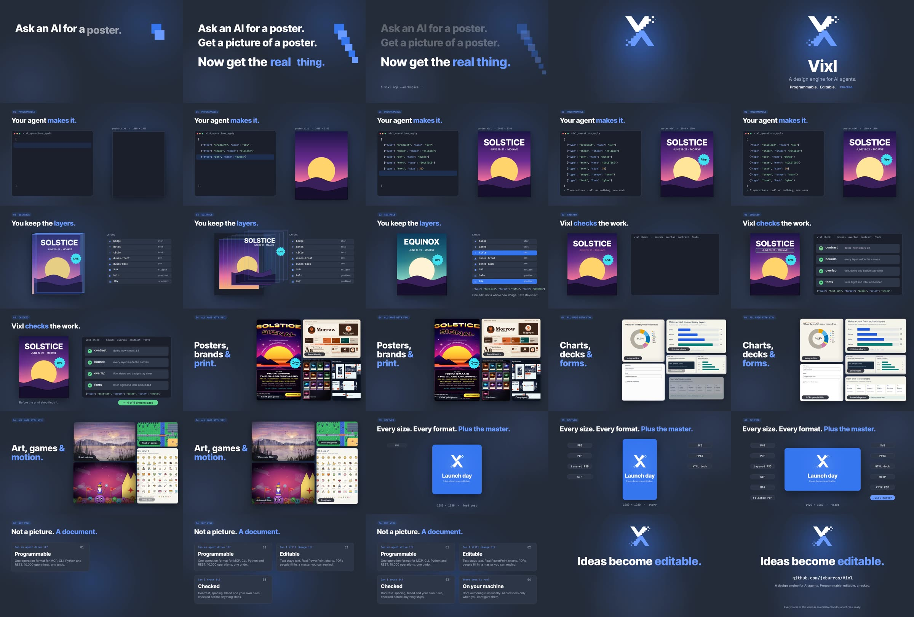

# Vixl in 60 seconds

**Ideas become editable.** A one-minute video about Vixl, the design engine for AI agents. Every frame
comes from an editable Vixl document, and the soundtrack is synthesised in code. Yes, the whole thing.

**[`vixl-in-60-seconds.mp4`](vixl-in-60-seconds.mp4)** · 60.0 s · 1920×1080 · 30 fps · AAC stereo 48 kHz · 7.4 MB



A companion film, [*It does that?*](it-does-that/README.md), shows nine of Vixl's less obvious features.

A [promo variety pack](variety/README.md) adds six distinct treatments with editable masters and a
36-second preview reel. Built-in templates also offer portrait and widescreen versions.

## The cut

The middle of the video walks through the three pillars from [the brand voice guide](../docs/brand-voice.md):
your agent makes it, you keep the layers, Vixl checks the work.

| Time | Shot | What it says |
| --- | --- | --- |
| 0:00 | `01-hook` | "Ask an AI for a poster. Get a picture of a poster. Now get the real thing." |
| 0:06 | `02-logo` | The Ripple wordmark builds letter by letter and its reflection ripples in: *A design engine for AI agents. Programmable. Editable. Checked.* |
| 0:10 | `03-build` | **Programmable.** "Your agent makes it." Operations type out on the left, and a poster builds itself layer by layer on the right |
| 0:20 | `04-edit` | **Editable.** "You keep the layers." The poster fans out into its layers and closes again, and one `text-set` turns SOLSTICE into EQUINOX |
| 0:26 | `05-check` | **Checked.** "Vixl checks the work." The contrast check flags the dim dates line, the fix lands, and four of four checks pass |
| 0:32 | `06-graphics` | All made with Vixl, from `explorations/`: print poster, brand identity, card sets, campaigns |
| 0:36 | `07-data` | Infographics, editable charts, slide decks, PDFs people fill in, routed diagrams |
| 0:40 | `08-art` | Brush painting (which crossfades to its watercolor filter), pixel-art games, emoji sets, *The Germ King* |
| 0:44 | `09-deliver` | "Every size. Every format. Plus the master." One design reflows from a 1:1 post to a 9:16 story and a 16:9 video |
| 0:50 | `10-why` | "Not a picture. A document." Four questions, each with an answer: Programmable · Editable · Checked · On your machine |
| 0:56 | `11-end` | *Ideas become editable.* · github.com/jxburros/Vixl |

The contrast figures in shot 5 are not made up. `make_video.py` runs `check` on the poster with its dim
dates line and quotes the ratio Vixl reports (2.66:1 against a 3:1 minimum). It then checks the corrected
poster and stops the build if any `fix` finding remains. The JSON on screen in shots 3–5 is shortened so
it stays readable. The poster itself is built from complete operations (`scenes.py`, `poster()`).

## What is in this folder

| Path | What it is |
| --- | --- |
| `vixl-in-60-seconds.mp4` | The finished video |
| `scenes/*.vixl` | Eleven editable 1920×1080 masters with keyframe timelines, fonts and images embedded |
| `film-spec.json` | The `film-export` request: shot order, durations and the two-track audio mix |
| `build/kit.py` | Brand constants, operation builders and motion shorthands |
| `build/scenes.py` | The eleven shots |
| `build/score.py` | A numpy synthesiser: a 120 BPM score (vi–IV–I–V, sidechained bass and pads, arpeggios) and effects cued to on-screen events |
| `build/make_video.py` | Builds the scenes, writes `audio/*.wav` (not committed) and runs `film-export` |
| `build/preview.py` | Writes contact sheets of sampled frames for quick review |
| `assets/germ-king.png` | A still from `movie/the-germ-king.mp4`, used in shot 8 |

## Rebuild

You need Python 3.11+, ffmpeg on `PATH`, and network access the first time, when Vixl downloads
Inter Tight, Inter and JetBrains Mono.

```bash
python -m pip install -e .
python promo/build/make_video.py            # scenes, audio and the MP4 (about 4 minutes on 4 cores)
python promo/build/make_video.py --scenes   # rebuild only the masters
cd promo/build && python preview.py /tmp 03 04   # contact sheets for selected shots
```

To change one shot, edit its master directly instead, for example
`vixl -p promo/scenes/10-why.vixl render --time 4s --out frame.png`, and then re-run `film-export` with
`film-spec.json`. Re-running `make_video.py` overwrites the masters.
