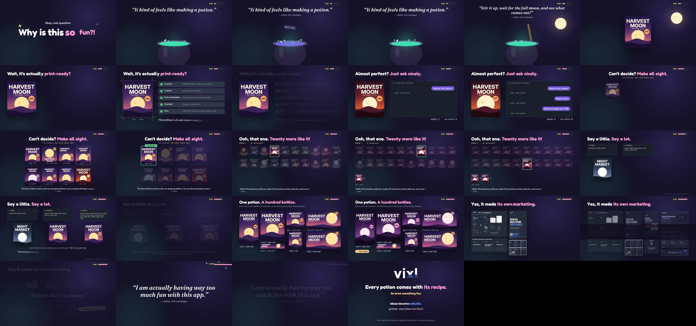

# Brew

**Okay, real question: why is this so fun?** A short, deliberately silly film about why making things with
Vixl is fun, in Jeffrey's words. Jeffrey is Vixl's developer, and he says it feels like brewing a potion: put
in your ideas, stir, wait for the full moon and see what comes out. What comes out is a real, editable design,
nearly ready to print.

**[`brew.mp4`](brew.mp4)** · 84.5 s · 1920×1080 · 30 fps · AAC stereo 48 kHz



## Two voices, and a different look

Jeffrey's lines are set in Fraunces italic, in quotation marks, with his name under each one. The potion
talk is his.

The narrator is looser than the rest of Vixl on purpose. This film is about fun, so it leaves the usual
[brand voice](../../docs/brand-voice.md) behind: Fredoka headlines instead of Inter Tight, potion pink
instead of brand blue, words that bounce in, and a running joke, a FUN meter in the corner that fills up a
little every shot until it breaks on Jeffrey's last line. The Vixl logo, *Ideas become editable.* and the
facts stay as they are.

## The cut

| Time | Shot | What it says |
| --- | --- | --- |
| 0:00 | `00-hook` | "Okay, real question: Why is this so fun?!" Sparkles, and the FUN meter appears |
| 0:03 | `01-ingredients` | Jeffrey: *"It kind of feels like making a potion."* An idea, autumn vibes, bold type, 1080 × 1350, a moodboard, brand colours and a vague feeling fall into a cauldron, and each one changes the brew's colour |
| 0:11 | `02-moon` | Jeffrey: *"Stir it up, wait for the full moon, and see what comes out!"* The moon rises and a poster comes out of the pot. Ta-da |
| 0:18 | `03-ready` | "Wait, it's actually print-ready?" Trim and bleed marks; live text, layer count, embedded fonts, check results and print output. Jeffrey: *"Everything is already almost ready for print."* |
| 0:25 | `04-adjust` | "Almost perfect? Just ask nicely." Three requests (warmer sky, bigger moon, a 7 PM badge) change the same poster. Edits 3, re-rolls 0 |
| 0:33 | `05-eight` | "Can't decide? Make all eight." Eight fixes for a title that feels lost, side by side. Ooh, this one |
| 0:41 | `06-rounds` | "Ooh, that one. Twenty more like it!" Three rounds of twenty variations, each narrower than the last. 60 designs seen, 3 happy picks |
| 0:50 | `07-direction` | "Say a little. Say a lot." Three briefs, from one sentence to a full spec, and the poster each gives. Small models make something tidy, if a little plain; tell it more, get more |
| 0:58 | `08-bottles` | "One potion. A hundred bottles." One recipe at seven sizes (story, poster, post, link card, flyer, slide, banner), then the whole set again in plum. Like a family photo where nobody blinked |
| 1:06 | `09-self` | "Yes, it made its own marketing." The [marketing pack](../../marketing/README.md) as a wall. Jeffrey: *"I think that's so funny."* Including this video. Hi! |
| 1:13 | `10-fun` | Jeffrey: *"I am actually having way too much fun with this app."* The FUN meter overshoots off the edge of the frame. Meter broke |
| 1:19 | `11-end` | "Every potion comes with its recipe. Go brew something fun." *Ideas become editable.* and the repository link |

Every poster in the film comes from one function, `harvest()` in `build/potion.py`. It lays itself out for the
box it gets, which is how the hero, the eight fixes, the sixty variations and the seven sizes stay one family.
The variations in shot 6 come from a seeded generator: round 2 keeps the palette of the round-1 pick, and
round 3 also keeps its layout.

The figures in shot 3 come from a real check. `make_video.py` builds the hero poster at 1080 × 1350, runs
`check` for bounds, overlap, contrast and fonts, quotes the layer count and the number of checks, and stops
the build if any finding needs a fix. Shot 7 is labelled as an illustration: one recipe, three briefs, not
output from three different models.

## What is in this folder

| Path | What it is |
| --- | --- |
| `brew.mp4` | The finished video |
| `scenes/*.vixl` | Twelve editable 1920×1080 masters with keyframe timelines, fonts and images embedded |
| `film-spec.json` | The `film-export` request: shot order, durations and the two-track audio mix |
| `build/potion.py` | The Harvest Moon poster recipe, its ten palettes and the cauldron |
| `build/shots.py` | The twelve shots, the fun meter and the shared night sky |
| `build/score.py` | The score (i–VI–III–VII in D minor at 120 BPM) and effects, using the instruments in `../build/score.py` |
| `build/make_video.py` | Builds the scenes, runs the check for shot 3, writes `audio/*.wav` (not committed) and runs `film-export` |
| `build/preview.py` | Writes contact sheets of sampled frames for quick review |

Every shot shares one night sky, so a cut never moves the background. Each shot clears its foreground over
the last beat (`finish()` in `build/shots.py`), except for what the next shot picks up: the cauldron carries
from shot 1 into shot 2, the fun meter carries through every cut until shot 10, and the poster glides from the centre of shot 2 into its place in shots 3 and 4.

The film reuses the brand constants and operation helpers in [`../build/kit.py`](../build/kit.py), which also
builds [Vixl in 60 seconds](../README.md).

## Rebuild

You need Python 3.11+ and ffmpeg on `PATH`. The first run also needs network access, so Vixl can download
Inter Tight, Inter, JetBrains Mono, Fraunces and Fredoka (all under the SIL Open Font License).

```bash
python -m pip install -e .
python promo/brew/build/make_video.py              # scenes, audio and the MP4
python promo/brew/build/make_video.py --scenes     # rebuild only the masters
python promo/brew/build/preview.py /tmp 04 06      # contact sheets for selected shots
```

To change one shot, edit its master directly, for example
`vixl -p promo/brew/scenes/10-fun.vixl render --time 4s --out frame.png`, and then re-run `film-export`
with `film-spec.json`. Re-running `make_video.py` overwrites the masters.
