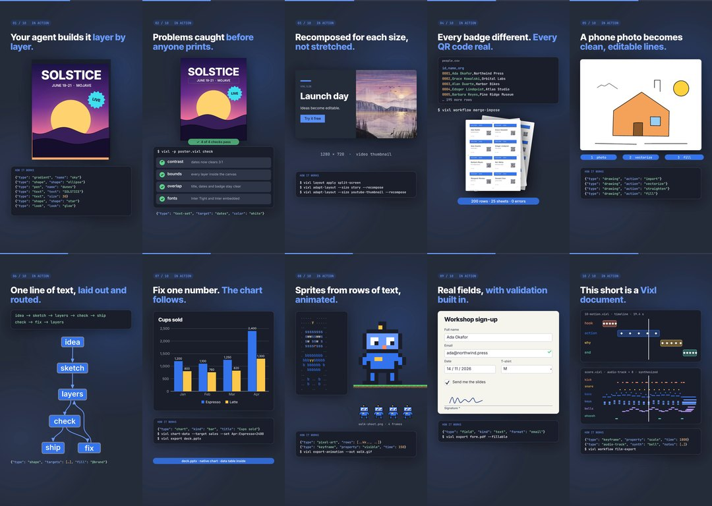

# Vixl shorts

**Ten vertical videos, one feature each.** Every short runs about 20 seconds at 1080 × 1920 for Reels,
Shorts and TikTok (19–20 s, 1.6–2.5 MB each), and follows the same four beats: the problem, the feature in action with the operations
that produce it ("how it works"), three reasons it matters, and the end card. Each short is one editable
Vixl master, and its soundtrack is a Vixl document too.



## The shorts

| # | Video | Feature | What runs in the build |
| --- | --- | --- | --- |
| 01 | [`vixl-short-01-layers.mp4`](vixl-short-01-layers.mp4) | Real layers | The festival poster from *Vixl in 60 seconds* builds from seven operations, fans out into its nine sheets, and one `text-set` renames SOLSTICE to EQUINOX |
| 02 | [`vixl-short-02-checked.mp4`](vixl-short-02-checked.mp4) | Checked before it ships | `check` runs on the poster with its dim dates line; the ratio on screen (2.66:1 against 3:1) is the one Vixl reports. The build stops if the fixed poster still has a `fix` finding |
| 03 | [`vixl-short-03-every-size.mp4`](vixl-short-03-every-size.mp4) | One design, every size | A `layout-apply` card, recomposed by `adapt-layout` with `recompose` for a story and a 16:9 thumbnail. The three cards on screen are those exports; each copy must pass `check` |
| 04 | [`vixl-short-04-print-run.mp4`](vixl-short-04-print-run.mp4) | Spreadsheet to print run | The badge run from *It does that?*: a 200-row CSV merged and imposed by `merge-impose` into 25 letter sheets with crop marks and a unique QR code per badge |
| 05 | [`vixl-short-05-sketch.mp4`](vixl-short-05-sketch.mp4) | Sketch to vectors | A synthesized phone photo of a pen sketch goes through `drawing` import, vectorize, straighten and fill; the stat line quotes `drawing report` |
| 06 | [`vixl-short-06-diagram.mp4`](vixl-short-06-diagram.mp4) | Text to diagram | `diagram-from-text` lays out and routes a two-line flow top to bottom; nodes and edges animate and recolour as ordinary layers |
| 07 | [`vixl-short-07-charts.mp4`](vixl-short-07-charts.mp4) | Charts that stay data | A `chart`, then one `chart-data` edit. Every bar, label, tick and gridline moves from its geometry before the edit to its geometry after it, and the PPTX export is opened to confirm it holds a native chart |
| 08 | [`vixl-short-08-pixel-art.mp4`](vixl-short-08-pixel-art.mp4) | Pixel art that walks | A robot written as `pixel-art` rows, four walk frames stepped with `visible` keys over a looping tile ground, and the frames as a sheet |
| 09 | [`vixl-short-09-forms.mp4`](vixl-short-09-forms.mp4) | Fillable forms | Real `field` layers (text, email, date, dropdown, checkbox, signature) on a paper card; the email rule catches a typo before it is fixed |
| 10 | [`vixl-short-10-motion.mp4`](vixl-short-10-motion.mp4) | Motion and sound | The short's own timeline and its own score as a piano roll, with playheads that track the frame you are watching |

The on-screen JSON is shortened where a full operation would not fit a phone screen, as in the promo films.
The commands shown are real Vixl commands.

## Captions for posting

| # | Caption |
| --- | --- |
| 01 | Ask an AI for a poster and you get a picture. Vixl gives your agent real layers, so one edit renames the event. |
| 02 | Vixl measures contrast, bounds, overlap and fonts before anything ships, and your agent fixes what it finds. |
| 03 | Design once. Vixl recomposes the layout for every size and checks each copy. |
| 04 | 200 badges from one CSV: merged, imposed on press sheets, every QR code different. |
| 05 | Snap a sketch, get clean vectors you can fill, recolour and export. |
| 06 | Type `idea -> sketch -> layers -> check -> ship` and get a laid-out, routed diagram where every node is a layer. |
| 07 | Fix one number and the whole chart follows. Exports as a native PowerPoint chart. |
| 08 | Type the sprite as rows of letters. Vixl animates the walk cycle and exports the sheet. |
| 09 | Fillable PDF forms with validation built in, made by your agent. |
| 10 | This short is a Vixl document: keyframes, a synthesized soundtrack and an MP4 export from the same file. |

## What is in this folder

| Path | What it is |
| --- | --- |
| `vixl-short-*.mp4` | The ten finished videos (H.264, AAC stereo 48 kHz) |
| `scenes/*.vixl` | Ten editable 1080 × 1920 masters with keyframe timelines; images and fonts embedded |
| `scores/*.vixl` | Each short's soundtrack as `audio-track` layers (built-in synthesizer, 120 BPM, a different key and chord loop per short) |
| `specs/*.json` | The `film-export` requests: the master, its duration and the mixed score |
| `build/short.py` | The vertical kit: the shared promo kit (`promo/build/kit.py`) at 1080 × 1920, plus the hook, why and end-card sections |
| `build/inputs.py` | Runs `check`, `adapt-layout`, the badge merge, the drawing pipeline and `chart-data` into `work/` (not committed) |
| `build/shorts.py` | The ten shorts |
| `build/score.py` | The scores as `audio-track` operations |
| `build/make_videos.py` | Builds everything and runs `film-export` per short |
| `build/preview.py`, `build/contact.py` | Contact sheets of sampled frames, and `contact-sheet.jpg` from the finished videos |

## Rebuild

You need Python 3.11+, ffmpeg on `PATH`, and network access the first time, when Vixl downloads
Inter Tight, Inter and JetBrains Mono. A short takes about eight minutes to render on one core, so run a few
at once on a bigger machine.

```bash
python -m pip install -e .
python promo/shorts/build/make_videos.py              # all ten: inputs, masters, scores and MP4s
python promo/shorts/build/make_videos.py 03 07        # only shorts 03 and 07
python promo/shorts/build/make_videos.py --scenes     # rebuild only the masters
python promo/shorts/build/preview.py /tmp 06          # contact sheet of sampled frames for short 06
python promo/shorts/build/contact.py                  # contact-sheet.jpg from the finished MP4s
```

To change one short, edit its master directly instead, for example
`vixl -p promo/shorts/scenes/07-charts.vixl render --time 8s --out frame.png`, and then re-run `film-export`
with `specs/07-charts.json`. Re-running `make_videos.py` overwrites the masters.

## Credits

The landscape in short 03 is `explorations/05-generative-painting`, painted with Vixl brushes. Names on the badges are invented.
