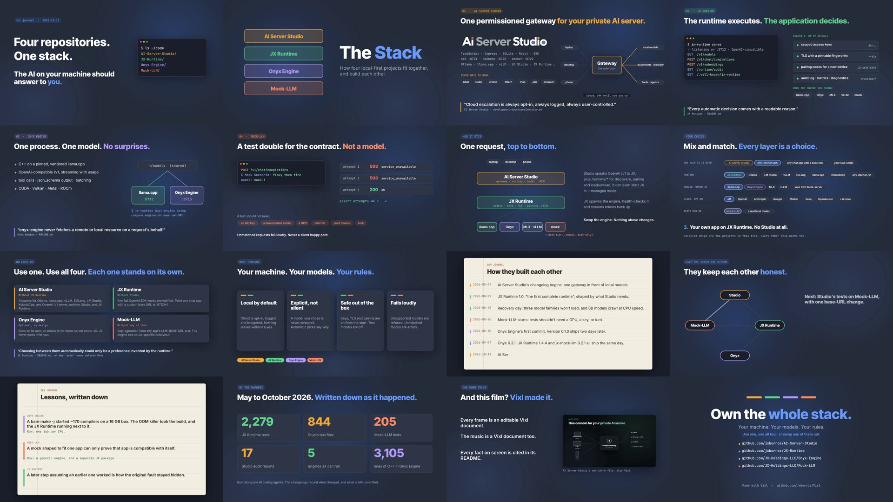

# The Stack

**Own the whole stack.** A film of about two and a half minutes about four sibling projects: AI Server Studio, JX Runtime,
Onyx Engine and Mock-LLM. It covers what each one is, how they fit together, how they give the person running
them more control, how every layer can be swapped for something else, and how each project helps develop and test the others. It is half explainer and half
developer's journal. Every frame comes from an editable Vixl document, and so does the soundtrack.

**[`the-stack.mp4`](the-stack.mp4)** · 2:36 · 1920×1080 · 30 fps · AAC stereo 48 kHz



## The cut

| Time | Shot | What it says |
| --- | --- | --- |
| 0:00 | `01-open` | *Dev journal · 2026-10-12.* "Four repositories. One stack. The AI on your machine should answer to you." `ls ~/code` lists the four repositories |
| 0:07 | `02-title` | Four coloured blocks stack up: **The Stack**, how four local-first projects fit together and build each other |
| 0:12 | `03-studio` | **AI Server Studio**: one permissioned gateway for your private AI server. The stack, the ports, seven work modes, and a gateway diagram (devices in, models and tools out, cloud off until you say so) |
| 0:24 | `04-runtime` | **JX Runtime**: "The runtime executes. The application decides." `jx-runtime serve` lists its endpoints, then come the security defaults and the engines it can run |
| 0:36 | `05-onyx` | **Onyx Engine**: one process, one model, no surprises. `dual-engine` serves the same model folder on llama.cpp `:8712` and Onyx `:8713` |
| 0:45 | `06-mock` | **Mock-LLM**: a test double for the contract, not a model. The `flaky-then-fine` scenario fails twice with 503, then succeeds, so a test can assert exactly three attempts |
| 0:55 | `07-stack` | How it fits: a request travels from a device through Studio and JX to an engine and back. Swap the engine and nothing above it changes |
| 1:07 | `08-choice` | Your choice: every layer of the stack as a row of options, of which these projects are only some (clients, runtimes, engines, opt-in cloud providers, test backends). Four combinations light up in turn: all four projects; Studio on Ollama; your own app on JX Runtime with no Studio; Studio with LM Studio and a cloud model you allowed |
| 1:19 | `09-standalone` | No lock-in: use one, use all four, each one stands on its own. What each project works with when the others are not there |
| 1:28 | `10-control` | More control: local by default, explicit rather than silent, safe out of the box, fails loudly |
| 1:38 | `11-journal` | Journal page: how they built each other, from Studio's first changelog entry to Alpha 0.7.3 |
| 1:50 | `12-loops` | They keep each other honest: four test relationships, each lit in turn with a quote from the repository |
| 2:02 | `13-lessons` | Journal page: three lessons the changelogs and docs wrote down, and what changed after each one |
| 2:14 | `14-numbers` | By the numbers |
| 2:21 | `15-vixl` | And this film? Vixl made it, and Studio's own intro film too |
| 2:28 | `16-end` | *Own the whole stack.* Use one, use all four, or swap any of them out. The four repository URLs |

## Where each fact comes from

Everything on screen was checked against the four repositories on 2026-10-12. Paths are relative to each
repository.

| Shot | Claim | Source |
| --- | --- | --- |
| 03 | "a local-first AI workspace for operating a private AI server through one permissioned gateway"; ports 8720/8721/8722; seven modes; runtime list | AI Server Studio `README.md`, `app/backend/src/runtime/registry.ts` |
| 03 | "Cloud escalation is always opt-in, always logged, always user-controlled." | AI Server Studio `development-docs/coreIdentity.md` |
| 04 | "The runtime executes. The application decides."; port 8712; endpoints; `jxr_` keys, `--tls` with fingerprint pinning, `JX-XXXX-XXXX` pairing codes; backends | JX Runtime `README.md`, `src/backends/` |
| 04 | "every automatic decision comes with a readable reason" | JX Runtime `README.md` |
| 05 | Pinned, vendored llama.cpp; endpoints; GPU backends; tool calls, `json_schema`, batching | Onyx Engine `README.md` |
| 05 | `dual-engine` puts Onyx on port 8713 next to the primary | JX Runtime `README.md` |
| 05 | "onyx-engine never fetches a remote or local resource on a request's behalf" | Onyx Engine `README.md` |
| 06 | "a test double for an LLM service contract, not a model"; `X-Mock-Scenario`; `mock-1`; `flaky-then-fine`; unmatched requests fail loudly | Mock-LLM `mock-llm-provider-spec.md`, `packages/mock-llm-engine/README.md`, `packages/mock-llm-engine/examples/scenarios.yaml` |
| 06 | "a test should not need an API key, a downloaded model, a GPU, internet access, paid tokens, or luck to pass" | Mock-LLM `mock-llm-provider-spec.md` |
| 07 | Studio drives JX over OpenAI `/v1` plus `/runtime/*` (discovery, pairing, load/unload) and can start it in `--managed` mode; the `mock` backend loads `.jxmock` packages | AI Server Studio `development-docs/architecture/models-and-runtimes.md`, `app/backend/src/services/jxRuntimeSupervisor.ts`; JX Runtime `src/backends/mock.js` |
| 08 | Studio's runtime adapters: Ollama, llama.cpp, vLLM, SGLang, LM Studio, KoboldCpp, JX Runtime, any OpenAI-compatible endpoint, and another Studio | AI Server Studio `app/backend/src/runtime/registry.ts` |
| 08 | Twelve opt-in cloud providers, six named on screen (OpenAI, Anthropic, Google, Mistral, Groq, OpenRouter) | AI Server Studio `app/backend/src/cloud/providers.ts` |
| 08, 09 | Any full OpenAI SDK works with JX Runtime unmodified; any chat client that lets you set a custom base URL works with it | JX Runtime `README.md` |
| 08 | JX Runtime's engines: llama.cpp (the default), Onyx Engine, MLX, vLLM, or your own `llama-server` build (`backends.llamacpp.autoManage: false`) | JX Runtime `README.md`, `src/backends/` |
| 09 | `'auto'` never selects Onyx: "choosing between them automatically could only be a preference invented by the runtime" | JX Runtime `README.md` |
| 09 | Onyx runs on its own (`onyx-engine -m model.gguf --port 8080`) or in place of `llama-server` under JX | Onyx Engine `README.md` |
| 09 | Mock-LLM is app-agnostic: `mock-llm-engine` has no JX-specific behaviour, and an app adopts it through `LLM_BASE_URL` | Mock-LLM `README.md`, `docs/adoption.md` |
| 10 | Cloud opt-in, logged and budgeted; an explicitly chosen model is never silently swapped | AI Server Studio `README.md` |
| 10 | Security on by default; test models off by default (`execution.allowTestModels`) | JX Runtime `README.md`, `src/backends/mock.js` |
| 10 | Unsupported models are refused with a clear error | Onyx Engine `README.md` |
| 11 | 2026-05-07 | AI Server Studio `docs/archive/changelog/CHANGELOG-2026-05.md` |
| 11 | 2026-08-09, JX Runtime 1.0.0 "the first complete runtime" | JX Runtime `CHANGELOG.md` |
| 11 | 2026-08-25, three model families would not load and 8B models decoded at roughly CPU speed | JX Runtime `docs/recovery-2026-08-25.md` |
| 11 | 2026-08-26, Mock-LLM's first commit; 2026-08-30, Onyx's first commit; Onyx 0.1.0 on 2026-09-01 | Mock-LLM and Onyx Engine git history, Onyx `CHANGELOG.md` |
| 11 | 2026-09-07: Onyx 0.3.1, JX Runtime 1.4.4, jx-mock-llm 0.2.1 | The three `CHANGELOG.md` files |
| 11 | 2026-10-11: Studio 0.7.3 | AI Server Studio `CHANGELOG.md` |
| 12 | Studio's nightly live CI runs a real JX Runtime: "a mock is not sufficient evidence on its own" | AI Server Studio `.github/workflows/live-runtime-integration.yml` |
| 12 | JX installs Onyx at `v0.3.1` and verifies it against the release's `checksums.txt`; "in place of a third-party `llama-server` binary" | JX Runtime `src/binaries.js`; Onyx Engine `README.md` |
| 12 | "A change in either repo that breaks the pairing fails here." | Mock-LLM `packages/jx-mock-llm/tests/contract.test.js` |
| 12 | Studio's tests on Mock-LLM are planned, not adopted (a base-URL change) | Mock-LLM `docs/adoption.md`; no Mock-LLM references in AI Server Studio |
| 13 | ~170 `cc1plus` processes, the OOM kill, one job per CPU since | Onyx Engine `CHANGELOG.md` |
| 13 | A mock shaped to fit one app is "only compatible with itself"; the generic engine and the JX package were split | Mock-LLM `README.md`, `CHANGELOG.md` |
| 13 | "A later step assuming an earlier one worked is how the original fault stayed hidden"; each step ends with a check and a STOP condition | JX Runtime `docs/recovery-2026-08-25.md` |
| 14 | 2,279 JX Runtime tests and 205 Mock-LLM tests (`test(` and `it(` calls); 844 Studio `*.test.ts(x)` files; 17 reports in Studio's `audits/`; 5 JX backends; 3,105 lines in Onyx's `src/*.cpp` | Counted in each repository |
| 15 | Studio's intro film was made with Vixl | AI Server Studio `marketing/intro-video/README.md`; the still is a frame of that film |

## What is in this folder

| Path | What it is |
| --- | --- |
| `the-stack.mp4` | The finished video |
| `scenes/*.vixl` | Sixteen editable 1920×1080 masters with keyframe timelines; images and fonts embedded |
| `score.vixl` | The soundtrack as an editable Vixl document: 100 BPM in D major, I–V–vi–IV, with the drums dropping out under the two journal pages |
| `film-spec.json` | The `film-export` request: shot order, durations and the audio track |
| `assets/` | The AI Server Studio wordmark (from that repository's `assets/brand/`) and a still from its intro film |
| `build/film.py` | Points the shared promo kit (`promo/build/kit.py`) at this folder and gives each project its colour |
| `build/scenes.py` | The sixteen shots |
| `build/score.py` | The score as `audio-track` operations |
| `build/make_video.py` | Builds everything and runs `film-export` |
| `build/preview.py` | Writes contact sheets of sampled frames for quick review |

## Rebuild

You need Python 3.11+, ffmpeg on `PATH`, and network access the first time, when Vixl downloads
Inter Tight, Inter and JetBrains Mono.

```bash
python -m pip install -e .
python promo/the-stack/build/make_video.py            # scenes, score and the MP4
python promo/the-stack/build/make_video.py --scenes   # rebuild only the masters
python promo/the-stack/build/preview.py /tmp 07 10    # contact sheets for selected shots
```

To change one shot, edit its master directly, for example
`vixl -p promo/the-stack/scenes/07-stack.vixl render --time 5s --out frame.png`, and then re-run
`film-export` with `film-spec.json`. Re-running `make_video.py` overwrites the masters.
