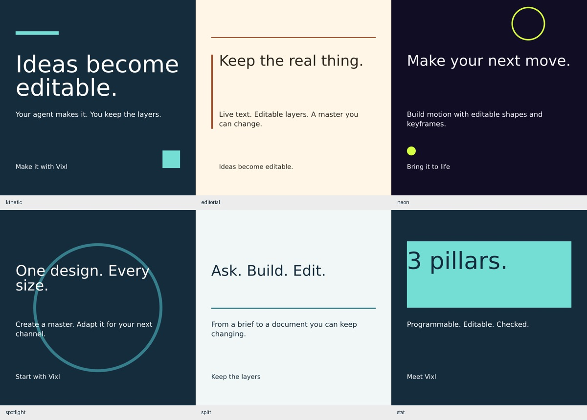

# Promo variety pack

Six editable treatments for Vixl promo clips: kinetic type, editorial framing, neon geometry,
product spotlight, split-screen comparison and a statistic reveal. Each holds its message before
returning to the background at the six-second loop boundary. The preview reel is silent.

[Watch the 36-second preview reel](promo-variety.mp4)



The `.vixl` masters contain live text, shapes and keyframes. `manifest.json` records the template,
seed, copy and colors used for each shot; `*-sheet.jpg` shows entrance, hold, exit and loop endpoints.
These are additional promo assets alongside the existing one-minute film and *It does that?*.

## Use a template

The built-in names are `video-promo-kinetic`, `video-promo-editorial`, `video-promo-neon`,
`video-promo-spotlight`, `video-promo-split` and `video-promo-stat`. The base name creates a
1080×1080 square. Add `-story` for 1080×1920 or `-wide` for 1920×1080. The portrait layouts
stack the comparison; its widescreen version uses two columns.

```bash
vixl template new video-promo-neon-story -o neon.vixl \
  --set 'title=Make your next move.' --set 'subtitle=Editable motion with Vixl.' --set 'cta=Bring it to life'
vixl -p neon.vixl render --time 2.5s --out neon-poster.png
```

Copy variables are `title`, `subtitle`, `cta`. Colors follow seeded palette roles unless overridden
with `background`, `foreground`, `accent`, `on_accent` variables. `palette` and `look` remain
available through normal template creation. Review bounds, contrast and a contact sheet with your
copy before export. Choose a visible poster at 2.5 seconds; the loop starts on the background.

## Rebuild

Install Vixl from this checkout and put ffmpeg on PATH, then run:

```bash
python promo/build/make_variety.py --out /tmp/my-promo-pack
python promo/build/make_variety.py --scenes --out /tmp/my-promo-proofs
```

The build checks bounds and contrast on each held composition, writes six full-resolution masters
and contact sheets, and exports a 540×540, 24 fps MP4 preview reel. It refuses an existing output
pack to protect edited masters; use a fresh destination when rebuilding.
